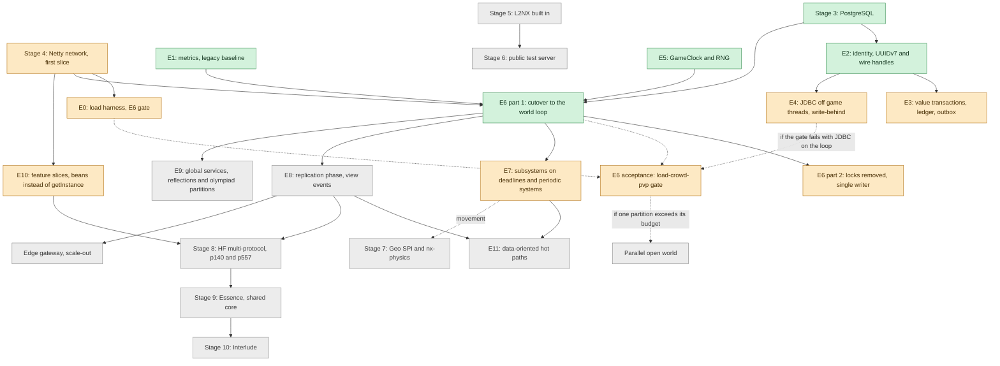
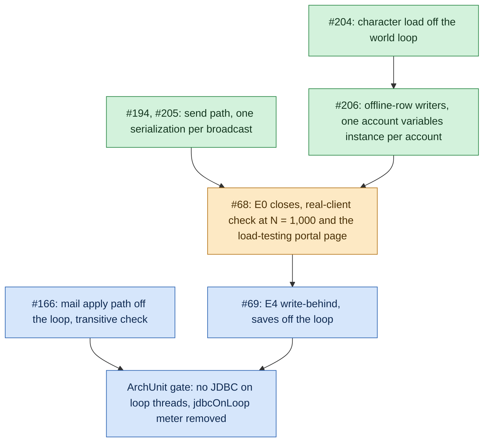

# nx-l2

An open-source Lineage 2 server built on [L2J Mobius](https://gitlab.com/MobiusDevelopment/l2j_mobius), with the
[L2NX](https://l2nx.dev) platform integration built in. One repository holds every chronicle (High Five first, then
Essence and Interlude), the login server, the network stack and the shared libraries.

> **Status: stage 3 done, stage 4 in progress.** High Five is imported from L2J Mobius; both servers run on Spring Boot with Actuator, metrics and a
> Docker image, on PostgreSQL with the schema managed by Liquibase. The design lives in
> [docs/specs/001-project-design.md](docs/specs/001-project-design.md); the stages in its §11, the import in
> [docs/provenance.md](docs/provenance.md). User documentation: [l2nx.dev/core](https://l2nx.dev/core/overview/), from
> [docs/public](docs/public) (English source, Russian translation).

## Quick start

Requirements: JDK 25, Docker. On Windows, clone with `git clone -c core.longpaths=true`: some script paths exceed
the default path limit.

```sh
docker compose up -d                          # PostgreSQL 18 `l2nx` with a schema and role per server, on 127.0.0.1:5432
./gradlew :login:boot:run                     # login server, client port 2106
./gradlew :chronicles:high-five:boot:run      # High Five game server, registers on the login server
```

`./gradlew installDist` builds runnable distributions in `login/boot/build/install/login-server` and
`chronicles/high-five/boot/build/install/game-server`; configuration is in their `config/` directories: the game and
login settings in `.ini` files, the database and the management surface in `config/application.yaml` (or environment
variables such as `SPRING_DATASOURCE_PASSWORD`). Geodata is not shipped: put it into `data/geodata` of the game server
distribution.

Each server also serves Spring Boot Actuator (health, info, Prometheus metrics, loggers, thread dump) on a management
port bound to `127.0.0.1`: `8106` for login, `8777` for game. Docker images are built from the distributions:

```sh
./gradlew :chronicles:high-five:boot:installDist
docker build -t l2nx/game-server chronicles/high-five/boot   # login: :login:boot:installDist, login/boot
```

Operator guide: [docs/public/en/operations.md](docs/public/en/operations.md). A load-test stack (login, game, database,
Prometheus and the harness in containers) is the Compose profile `load`; see
[docs/runbooks/load-baseline.md](docs/runbooks/load-baseline.md).

## Goals

- **A ready-made build.** Anyone who wants to run a server gets one, with L2NX integration out of the box. Without
  platform credentials it runs as a plain emulator.
- **Community development.** The engine is maintained in the open.
- **A reference implementation for education and research,** as Mobius positions itself.

## Principles

**Minimum custom code, maximum reuse of industry standards.** Where an established library, framework default or
convention covers the job, nx-l2 uses it as is instead of writing its own: Spring Boot defaults, standard Actuator
endpoints and Micrometer metric names, Log4j2, Liquibase, Testcontainers. Custom code is written only for what is
specific to Lineage 2, and every departure from a standard is a recorded decision in the spec.

## Roadmap

Where the engine migration of [spec 003](docs/specs/003-engine-core/spec.md#6-migration) stands. States: **done**
(landed on `main`, its gate holds), **in progress** (partly landed, open issues listed), **next** (the next item of
the near-term track), **later** (not started). Every step with its evidence and open issues:
[roadmap.md](docs/specs/003-engine-core/roadmap.md). Both are updated when a step changes state.

### Stages

Arrows are the dependencies of spec 003 §6; a dotted arrow is a conditional or acceptance dependency. Stages 3–10
are the project stages of [spec 001 §11](docs/specs/001-project-design.md#11-stages).



### Near-term track

The work in front of E4. The login-storm stall the E0 gate measured (2.0–2.4 s passes at about 17 arrivals per second)
came from loading characters on the loop; with #204 the `load-login-storm` gate passes with no database read on the
loop during the login ramp (pass p99 20.4 → 11.6 ms, [load-baseline.md](docs/runbooks/load-baseline.md#results)).
Steady play already measures `jdbcOnLoop` at 0.



## Layout

The target layout; the repository has `libs/boot`, `libs/database`, `libs/gslink`, `libs/logging`, `libs/network`, `engine/core`, `engine/mail`,
`protocols/login/c621`, `protocols/game/p267`, `login/`, `chronicles/high-five/` and `tools/load/`.

```
libs/          infrastructure with no Lineage 2 knowledge: boot, database, gslink (login-link transport), logging, network, telemetry
engine/        mechanics shared by every chronicle: geo, L2NX adapter host, shared core, mail
protocols/     one wire protocol each: opcodes, packet codecs, keys and frame cipher, shared by servers and load bots
login/         one login server for every chronicle
chronicles/    one self-contained directory per chronicle: server, scripts, datapack, boot
tools/         data preparation from the operator's own client; load/: the load harness (spec 009)
```

Details: [spec 001 §4](docs/specs/001-project-design.md#4-module-layout).

## License

The project license is [Apache 2.0](LICENSE). Licenses are assigned per file, following the
[REUSE](https://reuse.software) specification; every license text in use is in [LICENSES/](LICENSES):

- new and rewritten files: Apache 2.0;
- files taken from L2J Mobius keep their upstream license, MIT or GPLv3.

While any GPLv3 file remains in a build, that build as a whole is distributed under GPLv3. GPLv3 files are rewritten
over time, so that the whole build becomes free to distribute and modify in any way. `libs/` and `engine/` hold no GPLv3
code at all.

## Disclaimer

nx-l2 is an independent, non-commercial project for education, research and interoperability testing. It is not
affiliated with, endorsed or sponsored by any game publisher; all trademarks belong to their owners. The repository
contains no game client, no client assets, no geodata and no decompiled or leaked code. See [LEGAL.md](LEGAL.md).

## Contact

- Questions: [n1rmata@l2nx.app](mailto:n1rmata@l2nx.app)
- Takedown and legal notices: [support@l2nx.app](mailto:support@l2nx.app), subject "Notice"
  ([procedure](LEGAL.md#7-notice-and-takedown))
- Security vulnerabilities: [security@l2nx.app](mailto:security@l2nx.app)

## Contributing

See [CONTRIBUTING.md](CONTRIBUTING.md).
