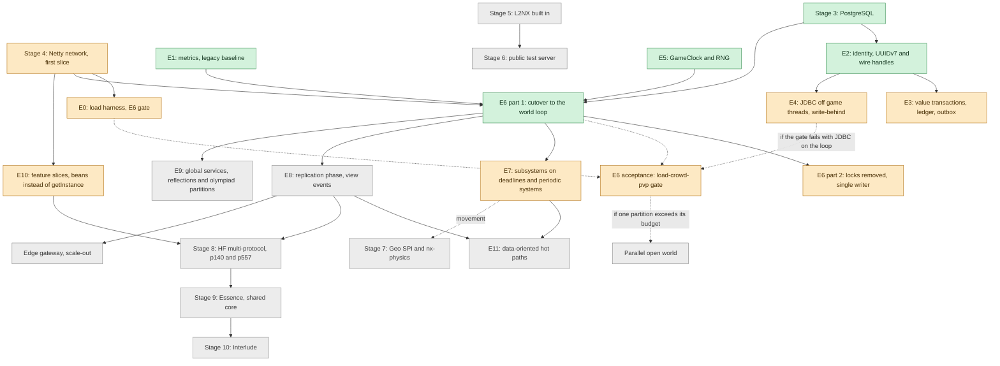
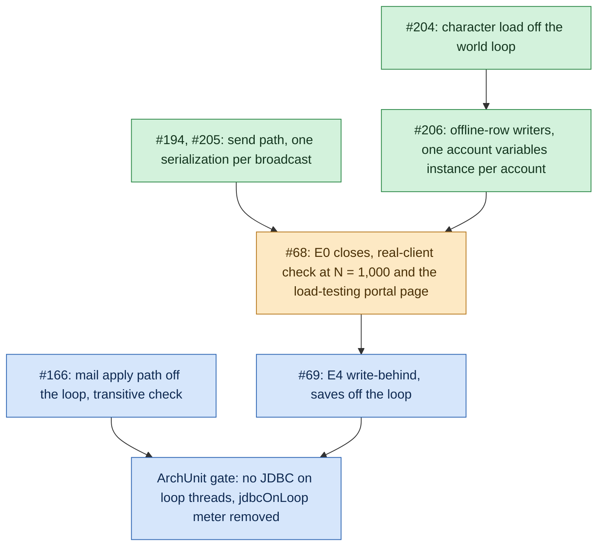

# 003 — Engine core: roadmap

Where the migration of [spec 003 §6](spec.md#6-migration) stands: which steps are done, which are under way and
what is left. Part of [spec 003](spec.md). The steps themselves (goal, dependencies, gates) are defined in §6; this
file holds only their status and evidence. Updated when a step changes state or an issue of the track closes.

States: **done** (landed on `main`, its gate holds), **in progress** (partly landed, open issues listed), **next**
(the next item of the near-term track), **later** (not started).

## 1. Stages

Arrows are the dependencies of §6; a dotted arrow is a conditional or acceptance dependency. Stages 3–10 are the
project stages of [spec 001 §11](../001-project-design.md#11-stages).

## 2. Near-term track

The work in front of E4. The login-storm stall the E0 gate measured (2.0–2.4 s passes at about 17 arrivals per second)
came from loading characters on the loop; with #204 the `load-login-storm` gate passes with no database read on the
loop during the login ramp (pass p99 20.4 → 11.6 ms, [load-baseline.md](../../runbooks/load-baseline.md#results)).
Steady play already measures `jdbcOnLoop` at 0.

## 3. Status

| Step        | Goal                                                                                | Status      | Evidence and open issues                                                                                                                                                                                                                                                                                                                                                                                                                      |
| ----------- | ----------------------------------------------------------------------------------- | ----------- | --------------------------------------------------------------------------------------------------------------------------------------------------------------------------------------------------------------------------------------------------------------------------------------------------------------------------------------------------------------------------------------------------------------------------------------------- |
| Stage 3     | PostgreSQL baseline, Liquibase                                                      | done        | `6c7d91a8a`                                                                                                                                                                                                                                                                                                                                                                                                                                   |
| Stage 4     | Netty transport, protocol ports, first slice                                        | in progress | transport `bc7e6ce3f`, `b678c2cc2`, `2cff73f3a`; first slice [#91](https://github.com/l2nx/nx-l2/issues/91) closed; open: real-client checks that need a second client ([TODO.md](../../TODO.md))                                                                                                                                                                                                                                             |
| E0          | load harness in a separate process, E6 acceptance gate                              | in progress | `8f8f17fc9` login storm, `49143aad6` p267 game scenarios, `f69f2d318` gate on input time, `load-login-storm` gate after #204 PASS; open: [#68](https://github.com/l2nx/nx-l2/issues/68), [#111](https://github.com/l2nx/nx-l2/issues/111), [#113](https://github.com/l2nx/nx-l2/issues/113), [#114](https://github.com/l2nx/nx-l2/issues/114), [#137](https://github.com/l2nx/nx-l2/issues/137)                                                                                        |
| E1          | metrics: legacy baseline, then pass time per partition and phase                    | done        | `11aae784e` baseline meters, `65894a817` session input timing; open: [#103](https://github.com/l2nx/nx-l2/issues/103) heavy task attribution                                                                                                                                                                                                                                                                                                  |
| E2          | UUIDv7 keys, wire-handle allocator                                                  | done        | delivered inside stage 3, `6c7d91a8a`; open: [#107](https://github.com/l2nx/nx-l2/issues/107) handle contract                                                                                                                                                                                                                                                                                                                                 |
| E3          | value transactions, ledger, `idempotency_key`, outbox                               | in progress | mail on value transactions `9fee79b1d` ([#150](https://github.com/l2nx/nx-l2/issues/150)); open: [#155](https://github.com/l2nx/nx-l2/issues/155) trade, stores, warehouses, freight, auction, multisell, crafting                                                                                                                                                                                                                            |
| E4          | database access off game threads, write-behind with a 30 s window                   | in progress | character load off the loop `91a62a6fa` ([#204](https://github.com/l2nx/nx-l2/issues/204)), offline-row writers and one account variables instance per account ([#206](https://github.com/l2nx/nx-l2/issues/206)); open: [#69](https://github.com/l2nx/nx-l2/issues/69) saves still synchronous on the loop, [#166](https://github.com/l2nx/nx-l2/issues/166), [#106](https://github.com/l2nx/nx-l2/issues/106), [#104](https://github.com/l2nx/nx-l2/issues/104)                                                  |
| E5          | `GameClock` and RNG instead of the system clock and global random                   | done        | `006d4fe97`; open: [#102](https://github.com/l2nx/nx-l2/issues/102) randomness and scheduled-work gates                                                                                                                                                                                                                                                                                                                                       |
| E6 part 1   | cutover: world partition drains the sessions, `ThreadPool` replaced by the loop API | done        | `aa7f19723` loop core, `088700c17` world on a single writer loop, [#43](https://github.com/l2nx/nx-l2/issues/43) closed                                                                                                                                                                                                                                                                                                                       |
| E6 part 2   | locks and concurrent collections removed under the ownership check                  | in progress | entities under `entity/` single-writer: [#101](https://github.com/l2nx/nx-l2/issues/101), [#142](https://github.com/l2nx/nx-l2/issues/142), [#173](https://github.com/l2nx/nx-l2/issues/173) closed, ArchUnit and PMD gate `a1b0a39a6`, `64d7c2b3b`; open: [#161](https://github.com/l2nx/nx-l2/issues/161) managers, data tables, mechanics (142 files), [#177](https://github.com/l2nx/nx-l2/issues/177)                                    |
| E6 gate     | `load-crowd-pvp` keeps the world pass p99 within budget                             | in progress | baseline `ab1c9c725`: steady pass p99 1.5–2.2 ms of 50 ms at 500 load bots, trust checks failed ([spec 009 §8](../009-load-harness.md#8-gate)); open: [#68](https://github.com/l2nx/nx-l2/issues/68)                                                                                                                                                                                                                                          |
| E7          | subsystems on deadlines and periodic systems: effects, combat, casting, AI, regen   | in progress | AI think, movement and death rewards as loop systems `2a518771a`; open: [#45](https://github.com/l2nx/nx-l2/issues/45), [#122](https://github.com/l2nx/nx-l2/issues/122), [#42](https://github.com/l2nx/nx-l2/issues/42), [#31](https://github.com/l2nx/nx-l2/issues/31)                                                                                                                                                                      |
| E8          | replication phase, replicated world state as view events                            | later       | view event port exists for the first slice (`639a9c726`, `cd41893d4`); no replication phase yet; [#42](https://github.com/l2nx/nx-l2/issues/42)                                                                                                                                                                                                                                                                                               |
| E9          | global services, reflections and olympiad matches as their own partitions           | later       | —                                                                                                                                                                                                                                                                                                                                                                                                                                             |
| E10         | feature slices take over their packets, beans instead of static bridges             | in progress | first slice: login, character selection, chat, movement, enter world and restart ([#91](https://github.com/l2nx/nx-l2/issues/91)); open: [#41](https://github.com/l2nx/nx-l2/issues/41), [#73](https://github.com/l2nx/nx-l2/issues/73), [#49](https://github.com/l2nx/nx-l2/issues/49), [#132](https://github.com/l2nx/nx-l2/issues/132), [#141](https://github.com/l2nx/nx-l2/issues/141), [#172](https://github.com/l2nx/nx-l2/issues/172) |
| E11         | data-oriented hot paths where the profile shows them                                | later       | [#151](https://github.com/l2nx/nx-l2/issues/151)                                                                                                                                                                                                                                                                                                                                                                                              |
| Stages 5–10 | L2NX built in, public test server, Geo SPI, HF multi-protocol, Essence, Interlude   | later       | [#13](https://github.com/l2nx/nx-l2/issues/13), [#19](https://github.com/l2nx/nx-l2/issues/19), [#27](https://github.com/l2nx/nx-l2/issues/27), [#28](https://github.com/l2nx/nx-l2/issues/28), [#2](https://github.com/l2nx/nx-l2/issues/2), [#3](https://github.com/l2nx/nx-l2/issues/3)                                                                                                                                                    |
| Scale-out   | edge gateway, parallel open world, time dilation                                    | later       | [#4](https://github.com/l2nx/nx-l2/issues/4), [#21](https://github.com/l2nx/nx-l2/issues/21), [#20](https://github.com/l2nx/nx-l2/issues/20)                                                                                                                                                                                                                                                                                                  |
