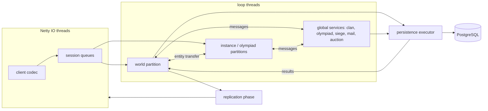

# 003 — Engine core

The target architecture of the game code: how the simulation runs, how game objects are modelled and wired, how
state reaches clients and the database, and the order in which the imported Mobius code gets there. Decides
[#18](https://github.com/l2nx/nx-l2/issues/18).

| File                                 | Covers                                                                                    |
| ------------------------------------ | ----------------------------------------------------------------------------------------- |
| `spec.md` (this file)                | principles, partitions, decisions at a glance, rejected alternatives, migration, deferred |
| [execution.md](execution.md)         | partition loop, inbox, session queues and packet order, timers, cadences, clock, threads  |
| [entities.md](entities.md)           | entity model, handles, static data, events, side effects, global services, scripts        |
| [effects.md](effects.md)             | buffs, debuffs and other effects on deadlines                                             |
| [replication.md](replication.md)     | client view, visibility grid, packet classes, per-connection budgets, network hand-off    |
| [persistence.md](persistence.md)     | identity (UUIDv7, wire handles), value transactions, ledger, write-behind, outbox, schema |
| [wiring-layout.md](wiring-layout.md) | Spring wiring, lifecycle, module and package layout                                       |

The research behind these decisions (tick models, mature MMO server cores, ECS, spatial scaling, persistence) is
published on l2nx.dev: `docs/public/{en,ru}/engine-research.md`.

## 1. Principles

- **The client is the only fixed contract.** The protocol, packet semantics and the measured behaviour of the
  client (movement echo, validation cadence, what it ignores) are given. The server behaviour of Mobius is not a
  parity target: every mechanism is chosen on its merits.
- **One writer per piece of state.** Every mutable game state has exactly one owning thread at a time. No locks,
  no concurrent collections in game state.
- **Time and randomness are inputs.** Game code reads a partition's `GameClock` and RNG, never the system clock or
  a global random. This makes a partition replayable and testable.
- **Industry practice over invention.** The shape below is what authoritative online games converge on; custom
  code is written only where Lineage 2 needs it (spec 001, principle in `CLAUDE.md`).
- **Every migration step keeps a playable server** ([spec 001 §11](../001-project-design.md#11-stages)).

## 2. Architecture at a glance

## 3. Partitions

- **A partition is a simulation space behind a hard game seam:** the open world, each instance, each olympiad
  match. Entities in different partitions never interact directly, so no cross-partition locking, ghosting or
  hand-off protocol is needed beyond moving an entity.
- **The contiguous open world is one partition.** It is not split into regions: splitting a seamless world across
  writers is the approach that failed in practice, and Lineage 2 concentrates load on exactly the borders a split
  would create (sieges). The fallback, if one thread proves insufficient, is
  [#21](https://github.com/l2nx/nx-l2/issues/21).
- **Partitions run in one process** on a pool of loop threads. A partition is executed by one thread at a time;
  there is no global barrier, so a heavy partition does not delay the others.
- **Global services** own state that spans partitions (clans and alliances, parties, olympiad, castle ownership and
  siege schedule, mail, auction, scripted world events). Each is a single writer with its own inbox:
  [entities.md §5](entities.md#5-global-services).
- **Partitions exchange messages only.** An entity moving into an instance is detached from one partition and
  attached to the other through their inboxes; it keeps its wire handle ([persistence.md §2](persistence.md#2-wire-handles)).

## 4. Decisions at a glance

| Concern      | Decision                                                                                                                    | Where                                                                                                |
| ------------ | --------------------------------------------------------------------------------------------------------------------------- | ---------------------------------------------------------------------------------------------------- |
| Execution    | event loop per partition: inbox + deadline timers + periodic systems on their own cadences; no fixed global tick            | [execution.md](execution.md)                                                                         |
| Packet order | strict FIFO per client session, fair round-robin across sessions                                                            | [execution.md §3](execution.md#3-inbox-and-session-queues)                                           |
| Time         | injected `GameClock` per partition, game time vs wall-clock classified per mechanic; exact deadlines with carried remainder | [execution.md §6](execution.md#6-clock-and-randomness)                                               |
| Entity model | objects as facades for scripts, composed of components; data-oriented storage only for profiled hot paths; no ECS rewrite   | [entities.md](entities.md)                                                                           |
| References   | entities refer to each other by handle through the partition registry, never by Java reference                              | [entities.md §2](entities.md#2-handles-and-registries)                                               |
| Events       | synchronous typed dispatch inside a partition, deferred side-effect queue, no async in-process events                       | [entities.md §4](entities.md#4-events-and-side-effects)                                              |
| Effects      | absolute deadlines on the partition timer wheel, stats recalculated once per pass                                           | [effects.md](effects.md)                                                                             |
| Replication  | separate phase after simulation: exact client view, coalescing, packet classes, byte budgets                                | [replication.md](replication.md)                                                                     |
| Identity     | UUIDv7 for everything persistent; `int32` wire handles allocated on load, reused after quarantine                           | [persistence.md](persistence.md)                                                                     |
| Values       | one PostgreSQL transaction per value transfer, balance + append-only ledger, idempotent `operation_id`                      | [persistence.md §3](persistence.md#3-value-transactions)                                             |
| Other state  | write-behind with dirty tracking, about 30 s loss window, synchronous save on logout                                        | [persistence.md §4](persistence.md#4-write-behind)                                                   |
| Wiring       | Spring beans for services, registries, systems; plain objects on the hot path; no Spring threading in partitions            | [wiring-layout.md](wiring-layout.md)                                                                 |
| Layout       | `engine/core` for runtime mechanisms; chronicle packages by feature slice, boundaries checked by Spring Modulith            | [wiring-layout.md §4](wiring-layout.md#4-layout)                                                     |
| Overload     | metrics and bot load tests; a lagging pass is never caught up in bursts; time dilation deferred                             | [execution.md §8](execution.md#8-budget-and-metrics), [#20](https://github.com/l2nx/nx-l2/issues/20) |

## 5. Rejected alternatives

- **One tick per region of the open world.** More parallelism on paper; in practice every border interaction
  becomes a distributed protocol, and border bugs turned into item duplication and loss in the projects that
  shipped it. Kept only as the measured fallback [#21](https://github.com/l2nx/nx-l2/issues/21).
- **A fixed global tick (100 ms or 50 ms) for everything.** A tick adds up to one period of latency to every input
  and quantizes combat timing. The event loop removes the input latency; heavy per-entity work still runs on fixed
  cadences ([execution.md §5](execution.md#5-periodic-systems)).
- **Timers on a shared thread pool (the Mobius model).** Hundreds of tasks from many threads touch the same objects;
  ordering is nondeterministic and correctness depends on ad-hoc locks.
- **A full entity-component-system rewrite.** No public precedent of a classic MMO server core on a pure ECS, the
  scripts (about 310k lines) are written against object facades, and the measured gain needs data-oriented storage
  only on a few hot paths. ECS ideas are kept: components as data owned by systems, a single place for side effects.
- **Actor per entity (Orleans, Akka).** Fits meta services, not combat: every interaction between two entities
  becomes a message exchange with its own races. Global services use the single-writer loop without a framework.
- **An asynchronous event bus inside the simulation.** Unpredictable ordering and allocation on the hot path.
- **`BIGINT` sequences for persistent ids.** Need a database round trip or block allocation on the simulation
  thread and collide when worlds merge or characters transfer. UUIDv7 is generated in process and unique
  globally.

## 6. Migration

The steps form a track that runs alongside the stages of [spec 001 §11](../001-project-design.md#11-stages); the
dependency column ties them together. Each step ships on its own, ends with a playable server and is accepted by a
bot load test that includes a siege scenario (E0). Until E0 exists, a step is accepted by its metrics (E1) and by
playing with a real client. Scripts keep calling the same facades at every step.

| #   | Step                                                                                                                                                                                                                                                                              | Depends on                               |
| --- | --------------------------------------------------------------------------------------------------------------------------------------------------------------------------------------------------------------------------------------------------------------------------------- | ---------------------------------------- |
| E0  | Bot load harness: headless clients speaking the High Five game protocol, scenarios for login, movement, PvE, PvP and a mass siege, run against the local Compose stack ([#19](https://github.com/l2nx/nx-l2/issues/19)); reports client-side latency and reads the server metrics | stage 4 (Netty client in `libs/network`) |
| E1  | Metrics: first a baseline of the legacy execution (task and packet durations per type, pool queue depths), then pass time per partition and phase as partitions appear ([execution.md §8](execution.md#8-budget-and-metrics))                                                     | spec 002 metrics                         |
| E2  | Identity: UUIDv7 keys in the PostgreSQL baseline, wire-handle allocator ([persistence.md §1–2](persistence.md))                                                                                                                                                                   | stage 3 (written into its baseline)      |
| E3  | Value transactions, ledger, `operation_id`, outbox                                                                                                                                                                                                                                | E2                                       |
| E4  | Database access off game threads; write-behind with a 30 s window                                                                                                                                                                                                                 | E2                                       |
| E5  | `GameClock` and RNG injected instead of the system clock and `Rnd`; behaviour unchanged                                                                                                                                                                                           | —                                        |
| E6  | World partition as single writer: session queues, and every `ThreadPool` task that touches the world routed into its inbox; then locks and concurrent collections removed                                                                                                         | stage 4 (Netty), E1, E5                  |
| E7  | Subsystems moved from `ThreadPool` timers to partition deadlines one at a time: effects, combat, casting, AI, regeneration; movement together with `nx-physics`                                                                                                                   | E6                                       |
| E8  | Replication phase                                                                                                                                                                                                                                                                 | E6                                       |
| E9  | Global services; instances and olympiad matches as their own partitions                                                                                                                                                                                                           | E6                                       |
| E10 | Package rework by feature slice, alongside E6–E9; moves and content changes in separate commits                                                                                                                                                                                   | —                                        |
| E11 | Data-oriented hot paths where the profile shows them                                                                                                                                                                                                                              | E7, E8                                   |

How E6 works without rewriting subsystems: `ThreadPool` keeps its timing, but the body of every task submitted by
game code is handed to the world partition's inbox and runs on the partition thread; client packets go through the
session queues ([execution.md §3](execution.md#3-inbox-and-session-queues)). Tasks that never touch game state
(database, network, maintenance) keep running on their own threads and are marked as such. From then on the world is
single-writer even though the code still looks like Mobius; E7 then replaces the timers themselves.

E6 is the step with the main risk: legacy code running on one thread may not fit the budget. E1 measures it before
E6 lands; an overrun is fixed by profiling, not by returning to shared-pool threading.

## 7. Deferred

- Time dilation for overloaded partitions: [#20](https://github.com/l2nx/nx-l2/issues/20).
- Parallel open world if one partition exceeds its budget: [#21](https://github.com/l2nx/nx-l2/issues/21).
- Replication and client wire in a separate process (edge gateway): [#4](https://github.com/l2nx/nx-l2/issues/4).
- Stable script API for other emulators, which `ScriptContext` prepares: [#5](https://github.com/l2nx/nx-l2/issues/5).
