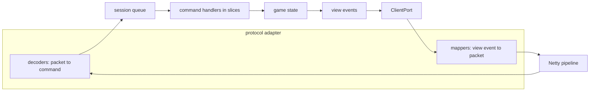

# 008 — Network

The transport for every connection (client↔game, client↔login, login↔game) and the multi-protocol design: how a
client protocol becomes an adapter in front of a game that knows no packets. Stage 4 of
[spec 001 §11](001-project-design.md#11-stages); the engine side (session queues, partitions, replication) is
[spec 003](003-engine-core/spec.md).

## 1. Principles

- **One transport: Netty.** The Mobius NIO2 stack and the blocking GS-link sockets are removed when stage 4 ends.
- **The game knows no protocol.** Game code receives commands and emits view events through ports; a client
  protocol is an adapter that maps packets to commands and view events to packets (§8). Adding a protocol adds
  mappers, not game code.
- **IO threads never touch game state.** They frame, decrypt, decode into commands and hand them to the session
  queue; they encrypt and write what the game serialized.
- **Netty defaults and idioms first:** pooled buffers, `EmbeddedChannel` tests, leak detection, the 4.2 IO API.
  Custom code only for Lineage 2 framing, ciphers and packets.

## 2. Layout

| Module / package                                 | Holds                                                                                                                         |
| ------------------------------------------------ | ----------------------------------------------------------------------------------------------------------------------------- |
| `libs/network` (`app.l2nx.network`)              | bootstraps, transport selection, framing, cipher contract and handler, frame encoder, limits, metrics, the ciphers            |
| `engine/core` `session`                          | session queue, session states, command dispatch, `ClientPort` ([wiring-layout §4](003-engine-core/wiring-layout.md#4-layout)) |
| `login/server` `protocol/<variant>/`             | login protocol variants (decoders, packets)                                                                                   |
| `login/server` `gslink`                          | login side of the GS-link                                                                                                     |
| `chronicles/<c>/server` `network`                | game pipeline, version handshake, protocol registry, GS-link client                                                           |
| `chronicles/<c>/server` `network/protocol/<id>/` | one client protocol adapter: inbound decoders, outbound mappers, serialization                                                |

`libs/network` knows no game rules; it knows bytes, frames and the Lineage 2 ciphers (LE Blowfish, rolling XOR,
XOR checksum).

## 3. Configuration

New settings are Spring Boot properties under `l2nx.network`, shared by both servers through
`@ConfigurationProperties` in `libs/network`; they replace `l2nx.login.network.*`. The game client port and the
GS-link address stay where the server reads them today (login: `l2nx.login.*`; game: `.ini` until
[#17](https://github.com/l2nx/nx-l2/issues/17)).

| Property                             | Default               | Meaning                                                                    |
| ------------------------------------ | --------------------- | -------------------------------------------------------------------------- |
| `transport`                          | `auto`                | `auto`, `epoll`, `nio`, `io-uring` (§4)                                    |
| `worker-threads`                     | Netty default         | IO threads per process                                                     |
| `max-frame`                          | 16 KB                 | largest inbound frame; larger closes the connection                        |
| `read-timeout`                       | 120 s                 | a connection that sends nothing before `IN_GAME` is closed                 |
| `ping-interval`                      | 30 s                  | in game, read idle this long sends `NetPing`                               |
| `ping-misses`                        | 3                     | unanswered pings in a row that close an in-game connection                 |
| `handshake-timeout`                  | 10 s                  | time from accept to the protocol version (game) or `AuthGameGuard` (login) |
| `auth-timeout`                       | 60 s                  | time from accept to a completed login or game authentication               |
| `inbound-queue-limit`                | 256                   | session queue capacity (§5)                                                |
| `packets-per-drain`                  | 16                    | items one session drain run executes before E6 (§5)                        |
| `packets-per-second`                 | 200                   | sustained inbound packets per session; burst = `inbound-queue-limit`       |
| `decode-error-limit`                 | 10 per 60 s           | decode errors tolerated in game before the connection is closed            |
| `write-buffer-low` / `-high`         | 32 KB / 128 KB        | Netty write watermarks                                                     |
| `outbound-limit`                     | 1 MB                  | pending outbound bytes per connection (queue plus channel buffer)          |
| `slow-client-timeout`                | 10 s                  | longest time a connection may stay unwritable                              |
| `connections-per-ip`                 | 10                    | concurrent connections from one address                                    |
| `accept-per-ip-per-second`           | 5                     | new connections from one address                                           |
| `max-connections`                    | 10000                 | concurrent connections per server                                          |
| `gslink.secret`                      | none (required)       | shared secret of the GS-link challenge (§10)                               |
| `gslink.tls`                         | `false`               | TLS on the GS-link                                                         |
| `gslink.ping-interval`               | 15 s                  | ping on write idle; no read for 3 intervals closes the link                |
| `gslink.reconnect-delay`             | 1 s, doubling to 30 s | reconnect backoff of the game server                                       |
| `shutdown-quiet-period` / `-timeout` | 2 s / 15 s            | `shutdownGracefully` of the event loop groups                              |

## 4. Event loops and transports

- **Netty 4.2 IO API:** `MultiThreadIoEventLoopGroup` with an `IoHandlerFactory`; the version comes from the Spring
  Boot BOM, the native transports (epoll for x86_64 and aarch64, io_uring) from the version catalog.
- **Transport:** `auto` uses epoll when `Epoll.isAvailable()` and NIO otherwise, logging why it fell back. io_uring
  is opt-in because the default Docker seccomp profile blocks its system calls.
- **Groups:** one boss thread and one worker group per process, shared by every bootstrap in it.
- **Allocator:** Netty's default (adaptive, pooled). Buffers allocated on non-Netty threads (serialization, §6) use
  the same allocator; their thread caches are bounded by the allocator's defaults.

## 5. Inbound pipeline

Game connection, in order:

1. **Accept filter:** bans and `connections-per-ip`, `accept-per-ip-per-second`, `max-connections`, checked in
   `initChannel` before any byte is read.
2. **Timeouts:** `IdleStateHandler`: until `IN_GAME` read idle for `read-timeout` closes the connection; in game
   read idle for `ping-interval` sends `NetPing`, and `ping-misses` unanswered pings close it; `handshake-timeout` and `auth-timeout` timers on the event
   loop, cancelled when the session reaches the state.
3. **Framing:** `LengthFieldBasedFrameDecoder`, little-endian, 2-byte length that counts itself
   (`lengthAdjustment = -2`, `initialBytesToStrip = 2`), `max-frame`.
4. **Cipher:** decrypts the frame in place; the frame is a retained slice of the decoder's cumulation and is
   writable.
5. **Packet decoder:** one decoder per channel that delegates to the channel's current adapter (§8). It reads the
   opcode (one byte, and for extended packets of High Five `0xD0` plus a 2-byte sub-opcode) and looks up
   `(session state, opcode)` in the adapter's immutable table. It only parses: strings are read with a length
   bound, values it keeps are copied, and the frame is released before the command is enqueued; commands never
   hold a `ByteBuf`.
   - An unknown opcode is counted and dropped, logged rate-limited, never with a stack trace.
   - A decode error before `IN_GAME` closes the connection; in game, errors are counted and more than
     `decode-error-limit` closes it.
6. **Session handler:** rate-limits the session (`packets-per-second`, a Bucket4j local bucket) and offers the
   command to the session queue, a bounded SPSC queue of `inbound-queue-limit`
   ([execution.md §3](003-engine-core/execution.md#3-inbox-and-session-queues)). A full queue or an empty bucket is
   a flood and closes the connection.

**Who drains the session queue.** One drain per session runs at a time, so a session's commands execute strictly
in order. Before the world partition exists (E6), the drain runs on the legacy packet pool: a session with input is
scheduled once, executes up to `packets-per-drain` items and reschedules itself if more are queued. From E6 the
owning partition drains the queue in its inbox phase with the engine's `packets-per-pass`; outside the world
(session states, §8; [execution.md §3](003-engine-core/execution.md#3-inbox-and-session-queues)) the session drain
stays.

## 6. Outbound path

- **The adapter serializes on the thread that emits the view event or legacy packet** (the owner of the game state
  it reads), into a pooled buffer with 2 bytes of headroom for the length and, for login, tailroom for padding and
  checksum. Nothing reads game state on an IO thread.
- **One frame encoder** finishes the frame on the IO thread: encrypts in place and fills in the length when the
  buffer is not shared (reference count 1); copies first and then does the same when it is shared. The game cipher
  never covers the length bytes.
- **Serialized once per audience.** A view event for many sessions is serialized once per
  `(adapter, viewer variant)`; a mapper declares whether its output depends on the viewer (relation, karma colour,
  attackable flag) and how viewers group. Each session receives a retained duplicate.
- **Buffer ownership:** the emitter holds one reference and releases it after the fan-out; each queued duplicate is
  released by the encoder after writing, or by the outbound drain or the close path when the channel closes, the write fails or
  the event loop rejects the task during shutdown.
- **One ordered outbound queue per connection** (MPSC), drained on its event loop:
  - an atomic `scheduled` flag guards one outbound drain task; the drain clears it and re-checks the queue, so no
    wake-up is lost; outside passes it writes at most a batch per run with `voidPromise()`, flushes once and
    reschedules if items remain;
  - the outbound drain is the only writer of the channel: the key packet, legacy packets and view events all go through it;
    a direct `channel.write` from another thread is forbidden, since the rolling XOR depends on write order;
  - from E8, view events and legacy packets emitted in any phase of a pass are buffered per session in emission
    order and released by the replication phase after its spawns; the partition schedules each connection's
    outbound drain once, after the replication phase, and the drain writes everything and flushes once
    ([replication.md §6](003-engine-core/replication.md#6-network-hand-off)).
- **Failures:** a tail handler counts, logs rate-limited and closes on exceptions, which with `voidPromise()` are
  the only failure signal. A send that must precede a close (server close, kick, leave world) uses a real promise
  that closes the channel when the write completes.

## 7. Backpressure and protection

- **Slow readers:** watermarks signal; `outbound-limit` caps memory. Pending bytes over `outbound-limit` close the
  connection at once; a connection unwritable for longer than `slow-client-timeout` is closed too. Dropping
  coalescable and cosmetic events of a busy connection is the replication budget
  ([replication.md §5](003-engine-core/replication.md#5-priority-and-budgets)).
- **Floods:** the session rate limit and the bounded queue (§5); from E6 the partition's `packets-per-pass` keeps a
  fast client from delaying others.
- **Connections:** the accept filter (§5) and the handshake and authentication timeouts.

## 8. Ports and protocol adapters

The game exposes ports; a protocol adapter implements them for one client protocol.

### Commands and view events

- **Commands are intents of a player,** records owned by their feature slice: `movement.MoveTo`, `item.UseItem`,
  `trade.ConfirmTrade`, `html.FollowLink`. They are not one to one with packets: several packets may map to one
  command, one packet to several or to none. A link in an HTML dialog, a bypass and a chat command are commands
  of the slice that owns them.
- **View events are facts a client must learn,** records owned by their slices: `Spawned`, `Despawned`,
  `CreatureMoved`, `StatusChanged`, `MessageShown`, `HtmlDialogOpened`. An event carries handles and domain values;
  a mapper reads what else it needs from the slice's read-only views, on the thread that emits the event.
- **No wire values in ports:** commands and events carry domain enums and value types. Object references are wire
  handles ([persistence.md §2](003-engine-core/persistence.md#2-wire-handles)), which are protocol-independent.
  Messages are domain message keys with typed parameters (player, NPC, item, skill, number, text); each adapter
  maps a key to its client's string id and decides what to show when its client has no such message.
- **Each command has exactly one handler**, which declares where it runs: the session (outside the world), the
  owning partition, or a global service. A Spring bean holds the registry `command type → handler`.
- **Requests and dialogs** (trade, party invite, confirmation dialogs) are game state with a domain request id.
  The view event carries the id, the adapter maps it to its packet, the answering command carries it back, and the
  timeout is a deadline of the owner.
- **Game state is built by game code, never as a side effect of sending.** The actions an HTML dialog allows are
  recorded by the slice before it emits `HtmlDialogOpened`; the mapper only serializes. Mappers have no side
  effects.

### Session states

`CONNECTED → AUTHED → ENTERING → IN_GAME → CLOSING → DISCONNECTED`, plus `IN_GAME → AUTHED` on restart. States
are domain states in `engine/core`; each adapter maps them to its decoder tables. A command that arrives in a
state whose table does not contain it is dropped.

### Selection

- **The version handshake is protocol-independent.** The first packet of a game connection is the protocol
  version, read by the chronicle's handshake decoder on the IO thread before any adapter exists.
- **`GameProtocolRegistry`** maps the version to an adapter; the handshake sets the channel's adapter field, which
  the single packet decoder (§5) delegates to. Pipeline handlers are not replaced, so frames already buffered after
  the version are decoded by the new adapter.
- **Key exchange:** the adapter's key packet is the first outbound packet and goes out in clear; the encoder
  enables the rolling XOR in both directions right after encoding it. An unknown version is refused through the
  handshake's own refusal packet and the connection closes after the write; a ping version (`-2`) closes without a
  log line.

### Adapters

- **An adapter** (`network/protocol/<id>/`) holds the inbound decoders, the outbound mappers and their
  serialization. What its client cannot express is decided in its mapper.
- **Completeness is tested:** every command a client can send has a handler, and every view event has a mapper or
  an explicit drop, in each adapter.
- **The first adapter is `highfive`,** accepting protocol versions 267–273.
- **Further protocols** take their packet layouts from the Mobius builds of other chronicles and from a private
  reference server consulted for packet layouts and behaviour only, under the originality policy of
  [spec 001 §2](001-project-design.md#originality-policy).

### Legacy routes during the migration

Packets not yet moved to ports pass through the `highfive` adapter as they are:

- **Inbound:** a legacy packet runs its own `run()` from the same session queue, in order with commands.
  Coalescing (execution.md §3) is a property of command types and never applies to a legacy packet.
- **Outbound:** a legacy packet goes through `ClientPort.legacy(packet)` into the same ordered outbound queue (§6)
  and serializes itself. From E8, a legacy packet that names an object is held until the replication phase has
  spawned that object for the session, and dropped if the session does not see it.
- **Send-time side effects of legacy packets** (a packet's `runImpl` on the receiving player: chat snooping, the
  quest item list after the item list) move into handlers or systems when their slice moves, at the latest.
- **Scripts** send packets directly (`NpcSay`, `SystemMessage`, `NpcHtmlMessage` and others in about 460 files);
  they move to domain calls on the facades (`say`, `showHtml`, `message`) with their slice in E10, and
  `sendPacket` leaves the facades at the end of E10.
- **The gate:** an ArchUnit test counts legacy routes: inbound legacy opcodes in the `highfive` table, and
  references to server packet classes outside `network/protocol/highfive/`, scripts included. The count is pinned
  and may only fall; a migrated slice may not reference server packets. A test fails if the production
  configuration registers a second adapter while the count is above zero, and at start the server refuses a second
  adapter while the `highfive` table has legacy inbound entries; tests may register one through a test profile.
- **Order of migration:** inbound packets and the outbound packets of a slice (inventory, warehouse, skills,
  dialogs, clan windows) move with the slice in E10; the replicated world state (spawn, despawn, movement, status,
  appearance, cosmetic events) moves with the replication phase in E8. Each packet moves once.

## 9. Login

- **One port per protocol variant** ([spec 001 §8](001-project-design.md#8-login-and-multi-protocol)): the login
  server speaks first, so the port names the variant. `l2nx.login.client.ports` lists `{port, variant}` and replaces
  `l2nx.login.client.port`; each port has its
  own bootstrap and initializer on the shared groups. One variant exists today.
- **Handshake handler:** sends `Init` with the RSA public key and the session Blowfish key, then removes itself;
  timeouts per §5.
- **Cipher:**
  - outbound: the encoder pads the payload to 8 bytes, appends the XOR checksum, encrypts with Blowfish and fills
    in the length after padding; `Init` instead gets the XOR pass with a random key and the static Blowfish key;
  - inbound: Blowfish decrypt, then checksum verification; a bad checksum closes the connection.
- **Blocking and heavy work** (RSA decrypt of the credentials, account lookup, password check) runs on a bounded
  executor of virtual threads, ordered per channel; results return through the channel's event loop. Never on an
  IO thread.

## 10. GS-link

- **Netty on both ends:** the login server listens, the game server connects as a client and reconnects after a
  close with `gslink.reconnect-delay` backoff. A ping on write idle (`gslink.ping-interval`) keeps the link busy, and a link with no read for three intervals
  is closed as dead.
- **Authentication:** every registration answers a challenge: the login server sends a nonce, the game server
  returns its hex id, its chronicle and an HMAC-SHA256 over the nonce, the hex id and the chronicle under
  `gslink.secret`, so an answer cannot be replayed for another server. A link without a valid answer is closed. A new registration with the hex id of a live link replaces the old link and closes it.
- **Transport security:** the login server binds the GS-link to loopback by default (`l2nx.login.game-server.host`
  defaults to `127.0.0.1` instead of `*`). Across hosts, `gslink.tls`
  turns on Netty `SslHandler`, and the game server verifies the login server's certificate. The custom RSA and
  Blowfish exchange of Mobius is not kept.
- **Packets** carry the account by UUID ([persistence.md §1](003-engine-core/persistence.md#1-persistent-identity),
  [spec 006](006-database.md));
  the game server reports its chronicle when it registers.

## 11. Metrics

Micrometer, per server:

| Meter                            | Type    | Tags                                                                     |
| -------------------------------- | ------- | ------------------------------------------------------------------------ |
| `l2nx.network.connections`       | gauge   |                                                                          |
| `l2nx.network.bytes`             | counter | `direction` (`in`, `out`)                                                |
| `l2nx.network.commands`          | counter | `type`                                                                   |
| `l2nx.network.legacy.packets`    | counter | `type`, `direction`                                                      |
| `l2nx.network.decode.errors`     | counter | `state`                                                                  |
| `l2nx.network.dropped`           | counter | `reason`                                                                 |
| `l2nx.network.closed`            | counter | `reason` (`idle`, `timeout`, `flood`, `slow`, `outbound-limit`, `error`) |
| `l2nx.network.unwritable`        | counter |                                                                          |
| `l2nx.network.eventloop.pending` | gauge   | `loop`                                                                   |

Run time of commands is `l2nx.session.command` ([execution.md §8](003-engine-core/execution.md#8-budget-and-metrics)).

## 12. Shutdown

The network steps of the stop order of [spec 002](002-spring-boot-runtime.md#stop):

1. Close the server channels and stop reading on client channels (`autoRead = false`).
2. After the engine has saved the players, send the server close packet to each client with a close-on-write
   promise and wait for the writes up to `shutdown-timeout`.
3. Close the GS-link after the logout packets are flushed, bounded by `shutdown-timeout`.
4. `shutdownGracefully` with `shutdown-quiet-period` and `shutdown-timeout`.

## 13. Tests

- **Pipeline tests on `EmbeddedChannel`:** fragmented and merged frames, oversize frames, bad checksum, the login,
  game and GS-link handshakes, a frame buffered behind the protocol version, unknown opcodes, decode errors, queue
  overflow, rate limit, slow client and outbound limit, close with queued buffers.
- **Leak detection** at `paranoid` in every test JVM.
- **Golden tests** of the ciphers, of each adapter's decoders (bytes in, command out) and mappers (event in, bytes
  out).
- **Adapter completeness** (§8) and the legacy-route gate.
- **JMH:** encode, broadcast fan-out, decode.
- **End to end:** a real client logs in and plays at the end of the stage.

## 14. Stage 4 scope

Stage 4 is done when:

- all three connections run on Netty and the Mobius transport is gone;
- the port framework exists (commands, handler registry, `ClientPort`, session states, `GameProtocolRegistry`)
  with the `highfive` adapter and the legacy-route gate;
- the first slice runs through ports: character selection (`AuthLogin`, `CharacterSelect`, `CharacterCreate`,
  `CharacterDelete`, `CharacterRestore`, `RequestRestart`), entering the world (`EnterWorld`), movement
  (`MoveToLocation`, `ValidatePosition`, `CannotMoveAnymore`) and chat (`Say2`), inbound and outbound. Until the
  replication phase exists (E8), their view events reach observers through the legacy visibility of `World`;
- every other packet is a legacy route;
- a client logs in and plays.

## 15. Deferred

- Client protocol 140 over High Five content: [#27](https://github.com/l2nx/nx-l2/issues/27).
- Client protocol 557 over High Five content: [#28](https://github.com/l2nx/nx-l2/issues/28).
- Edge gateway: [#4](https://github.com/l2nx/nx-l2/issues/4).
