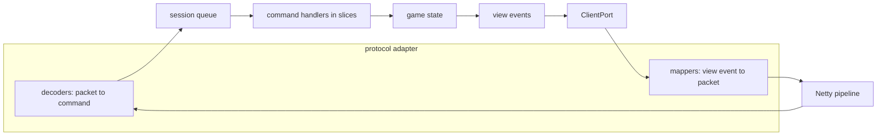

# 008 — Network

The transport for every connection (client↔game, client↔login, login↔game) and the multi-protocol design: how a
client protocol becomes an adapter in front of a game that knows no packets. Stage 4 of
[spec 001 §11](001-project-design.md#11-stages); the engine side (session queues, partitions, replication) is
[spec 003](003-engine-core/spec.md).

## 1. Principles

- **Netty for the client protocols, gRPC between our own servers.** The game client's protocol is the one fixed
  contract and runs on Netty with our framing and ciphers; the login↔game link is ours on both ends, so it uses the
  industry standard for service-to-service calls, gRPC over HTTP/2 through Spring Boot's gRPC support (§10). The
  Mobius NIO2 stack and the blocking GS-link sockets are removed when stage 4 ends.
- **The game knows no protocol.** Game code receives commands and emits view events through ports; a client
  protocol is an adapter that maps packets to commands and view events to packets (§8). Adding a protocol adds
  mappers, not game code.
- **IO threads never touch game state.** They frame, decrypt, decode into commands and hand them to the session
  queue; they encrypt and write what the game serialized.
- **Netty defaults and idioms first:** pooled buffers, `EmbeddedChannel` tests, leak detection, the 4.2 IO API.
  Custom code only for Lineage 2 framing, ciphers and packets.

## 2. Layout

| Module / package                                 | Holds                                                                                                                         |
| ------------------------------------------------ | ----------------------------------------------------------------------------------------------------------------------------- |
| `libs/network` (`app.l2nx.network`)              | bootstraps, transport selection, framing, cipher contract and handler, frame encoder, limits, metrics, the ciphers            |
| `engine/core` `session`                          | session queue, session states, command dispatch, `ClientPort` ([wiring-layout §4](003-engine-core/wiring-layout.md#4-layout)) |
| `login/server` `protocol/<variant>/`             | login protocol variants (decoders, packets)                                                                                   |
| `libs/gslink` (`app.l2nx.gslink`)                | the GS-link contract: `.proto` (`l2nx.gslink.v1`), generated stubs, the shared-secret interceptors, `l2nx.gslink` settings    |
| `login/server` `gslink`                          | login side of the GS-link: the gRPC service                                                                                   |
| `chronicles/<c>/server` `login`                  | the game server's side of the login server as a slice: online accounts, server listing, `LoginPort`, the login commands       |
| `chronicles/<c>/server` `network`                | game pipeline, version handshake, protocol registry, `gslink/` (the gRPC client of the GS-link, adapter of `LoginPort`)       |
| `chronicles/<c>/server` `network/protocol/<id>/` | one client protocol adapter: inbound decoders, outbound mappers, serialization                                                |

`libs/network` knows no game rules; it knows bytes, frames and the Lineage 2 ciphers (LE Blowfish, rolling XOR,
XOR checksum).

## 3. Configuration

New settings are Spring Boot properties under `l2nx.network`, shared by both servers through
`@ConfigurationProperties` in `libs/network`; they replace `l2nx.login.network.*`. The game client port stays where
the server reads it today (login: `l2nx.login.*`; game: `.ini` until [#17](https://github.com/l2nx/nx-l2/issues/17)).
The GS-link is configured by Spring Boot's gRPC properties (`spring.grpc.server.*` on the login server,
`spring.grpc.client.channel.login.*` on the game server: address, TLS through an SSL bundle, keepalive) plus
`l2nx.gslink` (§10).

| Property                               | Default        | Meaning                                                                                                                   |
| -------------------------------------- | -------------- | ------------------------------------------------------------------------------------------------------------------------- |
| `transport`                            | `auto`         | `auto`, `epoll`, `nio`, `io-uring` (§4)                                                                                   |
| `worker-threads`                       | Netty default  | IO threads per process                                                                                                    |
| `max-frame`                            | 16 KB          | largest inbound frame; larger closes the connection                                                                       |
| `read-timeout`                         | 120 s          | a connection silent before `AUTHED` (login: before auth, §9) is closed                                                    |
| `ping-interval`                        | 30 s           | from `AUTHED`, read idle this long sends `NetPing`                                                                        |
| `ping-misses`                          | 3              | unanswered pings in a row that close an authenticated connection                                                          |
| `handshake-timeout`                    | 10 s           | time from accept to the protocol version (game) or `AuthGameGuard` (login)                                                |
| `auth-timeout`                         | 60 s           | time from accept to a completed login or game authentication                                                              |
| `inbound-queue-limit`                  | 256            | session queue capacity (§5)                                                                                               |
| `packets-per-drain`                    | 16             | items one session drain run executes before E6 (§5)                                                                       |
| `max-concurrent-drains`                | 32             | session drains running at once before E6 (§5)                                                                             |
| `packets-per-second`                   | 200            | sustained inbound packets per session, at most 10^9 (Bucket4j's fastest refill); burst = `inbound-queue-limit`            |
| `decode-error-limit.count` / `.window` | 10 / 60 s      | decode errors after authentication, and failed commands or packets, tolerated per session before the connection is closed |
| `write-buffer-low` / `-high`           | 32 KB / 128 KB | Netty write watermarks                                                                                                    |
| `outbound-limit`                       | 1 MB           | pending outbound bytes per connection (queue plus channel buffer)                                                         |
| `slow-client-timeout`                  | 10 s           | longest time a connection may stay unwritable                                                                             |
| `connections-per-ip`                   | 10             | concurrent connections from one address                                                                                   |
| `accept-per-ip-per-second`             | 5              | new connections from one address                                                                                          |
| `max-connections`                      | 10000          | concurrent connections per server                                                                                         |
| `shutdown-quiet-period` / `-timeout`   | 2 s / 15 s     | `shutdownGracefully` of the event loop groups                                                                             |

## 4. Event loops and transports

- **Netty 4.2 IO API:** `MultiThreadIoEventLoopGroup` with an `IoHandlerFactory`; the version comes from the Spring
  Boot BOM, the native transports (epoll for x86_64 and aarch64, io_uring) from the version catalog.
- **Transport:** `auto` uses epoll when `Epoll.isAvailable()` and NIO otherwise, logging why it fell back. io_uring
  is opt-in because the default Docker seccomp profile blocks its system calls.
- **Groups:** one boss thread and one worker group per process, shared by every bootstrap in it.
- **Allocator:** Netty's default (adaptive, pooled). Buffers allocated on non-Netty threads (serialization, §6) use
  the same allocator; their thread caches are bounded by the allocator's defaults.

## 5. Inbound pipeline

Game connection, in order:

1. **Accept filter:** bans and `connections-per-ip`, `accept-per-ip-per-second`, `max-connections`, checked in
   `initChannel` before any byte is read.
2. **Timeouts:** `IdleStateHandler`: until `AUTHED` read idle for `read-timeout` closes the connection; from
   `AUTHED` read idle for `ping-interval` sends `NetPing`, and `ping-misses` unanswered pings close it. The client
   sends nothing on the character selection screen, so the ping starts there, not in game. `handshake-timeout` and
   `auth-timeout` are timers on the event loop, cancelled when the session reaches the state.
3. **Framing:** `LengthFieldBasedFrameDecoder`, little-endian, 2-byte length that counts itself
   (`lengthAdjustment = -2`, `initialBytesToStrip = 2`), `max-frame`.
4. **Cipher:** decrypts the frame in place; the frame is a retained slice of the decoder's cumulation and is
   writable.
5. **Packet decoder:** one decoder per channel that delegates to the channel's current adapter (§8). It reads the
   opcode (one byte, and for extended packets of High Five `0xD0` plus a 2-byte sub-opcode) and looks it up in the
   adapter's immutable table, one route per opcode. The decoder wraps the decoded command or legacy packet in the
   session's queue item itself, and the session handler offers that item as is: one allocation per packet. What an
   item needs from the game (a selected character, a character in the world) is checked when it runs (§8 Session
   states), never here. It only parses: strings are read with a length bound, values it keeps are copied, and the
   frame is released before the command is enqueued; commands never hold a `ByteBuf`.
   - An unknown opcode is counted and dropped, logged rate-limited, never with a stack trace.
   - A known opcode without a handler is counted as `ignored` and dropped.
   - The client's `NetPing` answer is consumed on the IO thread (it only proves the connection alive); it never
     reaches the session.
   - Before authentication (`CONNECTED`) only the routes marked pre-auth are read: the login packet. Any other
     packet is counted as `unauthenticated` and dropped undecoded, before the rate limit and the queue, so an
     unauthenticated client never reaches game code. The client sends nothing else before the server has answered
     its authentication, and the server moves the session on before it answers. This is the only filter the
     transport applies by route.
   - A decode error closes the connection before authentication; after it such errors are counted and more than
     `decode-error-limit` closes it. A decoder returning neither a command nor a legacy packet
     is a server bug: it reaches the tail handler, which logs its stack and closes with `error`.
6. **Session handler:** rate-limits the session (`packets-per-second`, a Bucket4j local bucket) and offers the
   command to the session queue, a bounded SPSC queue of `inbound-queue-limit`
   ([execution.md §3](003-engine-core/execution.md#3-inbox-and-session-queues)). A full queue or an empty bucket is
   a flood and closes the connection.

**Who drains the session queue.** One drain per session runs at a time, so a session's commands execute strictly in
order. Before the world partition exists (E6), the drain runs on the bounded virtual-thread executor of `libs/network`
(the one the login uses, §9), named `l2nx-game-packets` and bounded by `max-concurrent-drains`: a session with input is
scheduled once, executes up to `packets-per-drain` items and reschedules itself if more are queued. From E6 the session drain
keeps only the key exchange and the authentication (`CONNECTED`); once the session is `AUTHED` it is attached to the
world partition, which drains the queue in its inbox phase with the engine's `packets-per-pass`, character selection
included, since selecting, creating and entering load and create world objects
([execution.md §3](003-engine-core/execution.md#3-inbox-and-session-queues)).

## 6. Outbound path

- **The adapter serializes on the thread that emits the view event or legacy packet** (the owner of the game state
  it reads), into a pooled buffer with 2 bytes of headroom for the length and, for login, tailroom for padding and
  checksum. Nothing reads game state on an IO thread.
- **One frame encoder** finishes the frame on the IO thread: encrypts in place and fills in the length when the
  buffer is not shared (reference count 1); copies first and then does the same when it is shared. The game cipher
  never covers the length bytes.
- **Serialized once per audience.** A view event for many sessions is serialized once per
  `(adapter, viewer variant)`; a mapper declares whether its output depends on the viewer (relation, karma colour,
  attackable flag) and how viewers group. Each session receives a retained duplicate.
- **Buffer ownership:** the emitter holds one reference and releases it after the fan-out; each queued duplicate is
  released by the encoder after writing, or by the outbound drain or the close path when the channel closes, the write fails or
  the event loop rejects the task during shutdown.
- **A frame never outgrows its length field:** a frame longer than 65535 bytes after padding and checksum fails its
  write and closes the connection with `error`; the length is never truncated.
- **One ordered outbound queue per connection** (MPSC), drained on its event loop:
  - an atomic `scheduled` flag guards one outbound drain task; the drain clears it and re-checks the queue, so no
    wake-up is lost; outside passes it writes at most a batch per run with `voidPromise()`, flushes once and
    reschedules if items remain;
  - the outbound drain is the only writer of the channel: the key packet, legacy packets and view events all go through it;
    a direct `channel.write` from another thread is forbidden, since the rolling XOR depends on write order;
  - from E8, view events and legacy packets emitted in any phase of a pass are buffered per session in emission
    order and released by the replication phase after its spawns; the partition schedules each connection's
    outbound drain once, after the replication phase, and the drain writes everything and flushes once
    ([replication.md §6](003-engine-core/replication.md#6-network-hand-off)).
- **Failures:** a tail handler counts, logs rate-limited and closes on exceptions, which with `voidPromise()` are
  the only failure signal. A send that must precede a close (server close, kick, leave world) uses a real promise
  that closes the channel when the write completes.

## 7. Backpressure and protection

- **Slow readers:** watermarks signal; `outbound-limit` caps memory. Pending bytes over `outbound-limit` close the
  connection at once; a connection unwritable for longer than `slow-client-timeout` is closed too. Dropping
  coalescable and cosmetic events of a busy connection is the replication budget
  ([replication.md §5](003-engine-core/replication.md#5-priority-and-budgets)).
- **Floods:** the session rate limit and the bounded queue (§5); from E6 the partition's `packets-per-pass` keeps a
  fast client from delaying others.
- **Connections:** the accept filter (§5) and the handshake and authentication timeouts.

## 8. Ports and protocol adapters

The game exposes ports; a protocol adapter implements them for one client protocol.



### Commands and view events

- **Commands are intents of a player,** records in the `command/` package of their feature slice:
  `movement.command.MoveTo`, `item.command.UseItem`, `trade.command.ConfirmTrade`, `html.command.FollowLink`. They
  are not one to one with packets: several packets may map to one command, one packet to several or to none. A link
  in an HTML dialog, a bypass and a chat command are commands of the slice that owns them. What the login server
  sends is a command too (§10).
- **View events are facts a client must learn,** records in the `view/` package of their slices: `Spawned`,
  `Despawned`, `CreatureMoved`, `StatusChanged`, `MessageShown`, `HtmlDialogOpened`. An event carries handles and
  domain values; a mapper reads what else it needs from the slice's read-only views, on the thread that emits the event.
- **No wire values in ports:** commands and events carry domain enums and value types. Object references are wire
  handles ([persistence.md §2](003-engine-core/persistence.md#2-wire-handles)), which are protocol-independent.
  Messages are domain message keys with typed parameters (player, NPC, item, skill, number, text); each adapter
  maps a key to its client's string id and decides what to show when its client has no such message.
- **Each command has exactly one handler, and the handler's type declares where it runs.** A Spring bean holds the
  registry `command type → handler`, built from the handler beans; it refuses a second handler for a type.
  - **Session** (`SessionCommandHandler<C>`, `handle(Session, C)`): runs in the drain of the session's queue, in
    order with that client's packets, wherever the queue is drained (§5): on the session drain before E6; from E6
    on the session drain until `AUTHED` and on the world partition after it. The handler does not change when the
    drain moves. A client's own commands land in its session. A command from another edge that targets a
    session carries its address (`SessionAddressed`): the account (`SessionAddress.Account`) for a push such as a
    kick, or the correlation id of the request it answers (`SessionAddress.Request`, a UUIDv7 the game generated
    when it sent the request, since an answer may concern a client that has no account yet). The dispatcher finds
    the session and offers the command to its queue on the connection's event loop, so the queue keeps its single
    producer and internal input skips the rate limit. With no session for the address the command is counted as
    dropped (`no-session`) and logged at debug.
    Then the handler's `handleWithoutSession` runs on the sender's lane, so a push such as a kick still frees the
    login-side state of an account that has no live session.
    A client command that needs a game context (a selected character, a character in the world) gets it the way
    Spring MVC gets a handler argument from an argument resolver: its handler declares the context in its signature
    and the dispatcher resolves it from the session just before the call. A missing context rejects the command as
    for a legacy packet (§8 Session states); finer conditions stay the handler's own checks. The resolver comes with
    the first handler that takes a context.
  - **Global service** (`ServiceCommandHandler<C>`, `handle(C)`): runs on the serial lane of the service that owns
    the state (the GS-link stream for the `login` slice, §10; a service inbox from E9). No session is involved.
  - **Partition:** a world command not bound to a session, introduced with the world partition (E6).

  Routing by an address in the command is the pattern of Axon's target aggregate identifier and Pekko's sharded
  entity id; the registry stays ours because Spring has no command bus and its application events are neither
  typed per handler nor ordered per session.

- **Requests and dialogs** (trade, party invite, confirmation dialogs) are game state with a domain request id.
  The view event carries the id, the adapter maps it to its packet, the answering command carries it back, and the
  timeout is a deadline of the owner.
- **Game state is built by game code, never as a side effect of sending.** The actions an HTML dialog allows are
  recorded by the slice before it emits `HtmlDialogOpened`; the mapper only serializes. Mappers have no side
  effects.

### Session states

`CONNECTED → AUTHED → CLOSING → DISCONNECTED`: the lifecycle of the connection, in `engine/core`. The transport
uses it for one rule only: before authentication it reads nothing but the login (§5).

Whether a character is selected or in the world is game state, not a session state, and the transport never
filters by it. An item that needs it says so: it is a `ContextBound` and answers, just before it runs, whether its
context is present. The check runs in the session item's execution path, shared by the pre-E6 session drain and the
partition inbox, so it sees every change made by the items queued before it (a packet read right behind
`CharacterSelect` sees the selected character). An item without its context is rejected, not run: counted as
`l2nx.session.rejected` (tags `type`, `context`) and logged rate-limited at debug; an item that races the session's
close is discarded uncounted like the rest of the queue. Commands the server addresses to a session itself carry no
context and always run.

Legacy packets declare their context in the High Five opcode enums (`LegacyContext`), read from the client's game
state: `LOGIN` (the login, read before authentication and run only until an account is authenticated), `ACCOUNT` (an authenticated account), `LOBBY` (the selection
screen: no character selected), `CHARACTER` (a selected character, while the world loads or in it) and `WORLD`
(after `EnterWorld`), the default. The list of packets that run before the world follows what the real client
sends, not Mobius: the High Five client asks for skill reuse times, the key mapping, the manor list and the fortress list while the
world loads. A condition finer than the context (a repeated `EnterWorld`, a character that cannot log out now) is the
handler's own check. A ported command resolves the context its handler needs itself (§8 Commands and view events)
and is rejected the same way when it is missing; the legacy list shrinks as packets are ported.

### Selection

- **The version handshake is protocol-independent.** The first packet of a game connection is the protocol
  version, read by the chronicle's handshake decoder on the IO thread before any adapter exists.
- **`GameProtocolRegistry`** maps the version to an adapter; the handshake sets the channel's adapter field, which
  the single packet decoder (§5) delegates to. Pipeline handlers are not replaced, so frames already buffered after
  the version are decoded by the new adapter.
- **Key exchange:** the adapter's key packet is the first outbound packet and goes out in clear; the encoder
  enables the rolling XOR in both directions right after encoding it. An unknown version is refused through the
  handshake's own refusal packet and the connection closes after the write; a ping version (`-2`) closes without a
  log line.

### Adapters

- **An adapter** (`network/protocol/<id>/`) holds the inbound decoders, the outbound mappers and their
  serialization. What its client cannot express is decided in its mapper.
- **Completeness is tested:** every command a client can send has a handler, and every view event has a mapper or
  an explicit drop, in each adapter.
- **The first adapter is `highfive`,** accepting protocol versions 267, 268, 271 and 273.
- **Further protocols** take their packet layouts from the Mobius builds of other chronicles and from a private
  reference server consulted for packet layouts and behaviour only, under the originality policy of
  [spec 001 §2](001-project-design.md#originality-policy).

### Legacy routes during the migration

Packets not yet moved to ports pass through the `highfive` adapter as they are:

- **Inbound:** a legacy packet runs its own `run()` from the same session queue, in order with commands.
  Coalescing (execution.md §3) is a property of command types and never applies to a legacy packet.
- **Outbound:** a legacy packet goes through `ClientPort.legacy(packet)` into the same ordered outbound queue (§6)
  and serializes itself. From E8, a legacy packet that names an object is held until the replication phase has
  spawned that object for the session, and dropped if the session does not see it.
- **Send-time side effects of legacy packets** (a packet's `runImpl` on the receiving player: chat snooping, the
  quest item list after the item list) move into handlers or systems when their slice moves, at the latest.
- **Scripts** send packets directly (`NpcSay`, `SystemMessage`, `NpcHtmlMessage` and others in about 460 files);
  they move to domain calls on the facades (`say`, `showHtml`, `message`) with their slice in E10, and
  `sendPacket` leaves the facades at the end of E10.
- **The gate:** legacy routes are inbound legacy opcodes in the `highfive` table (a pinned count) and references to
  server packet classes outside `network/protocol/highfive/`, scripts included (a `FreezingArchRule` whose store
  lists them, §13). Both may only fall; a migrated slice may not reference server packets. A test fails if the production
  configuration registers a second adapter while the count is above zero, and at start the server refuses a second
  adapter while any adapter has legacy inbound entries; tests may register one through a test profile.
- **Order of migration:** inbound packets and the outbound packets of a slice (inventory, warehouse, skills,
  dialogs, clan windows) move with the slice in E10; the replicated world state (spawn, despawn, movement, status,
  appearance, cosmetic events) moves with the replication phase in E8. Each packet moves once.

## 9. Login

- **One port per protocol variant** ([spec 001 §8](001-project-design.md#8-login-and-multi-protocol)): the login
  server speaks first, so the port names the variant. `l2nx.login.client.ports` lists `{port, variant}` and replaces
  `l2nx.login.client.port`; each port has its
  own bootstrap and initializer on the shared groups. One variant exists today.
- **Handshake handler:** sends `Init` with the RSA public key and the session Blowfish key, then removes itself;
  timeouts per §5.
- **Cipher:**
  - outbound: the encoder pads the payload to 8 bytes, appends the XOR checksum, encrypts with Blowfish and fills
    in the length after padding; `Init` instead gets the XOR pass with a random key and the static Blowfish key;
  - inbound: Blowfish decrypt, then checksum verification; a bad checksum closes the connection with `error` and a
    rate-limited warning;
  - session key bytes are 1..255: the client reads the key from `Init` up to its first zero byte, so a zero inside
    the key would leave the two sides with different keys.
- **Blocking and heavy work** (RSA decrypt of the credentials, account lookup, password check) runs on a bounded
  executor of virtual threads, ordered per channel; results return through the channel's event loop. Never on an
  IO thread. A channel holds an executor slot for at most a batch of its tasks and then queues again behind the
  others (a fair semaphore), so a busy channel cannot starve logins; tasks the executor can no longer run after
  close go to the channel's rejection handler instead of running against a closing context.
- **Login states:** the packet decoder looks the opcode up whatever the state and hands the packet to the channel's
  lane; the packet checks the connection state there, just before it runs, and is dropped as
  `l2nx.network.dropped{reason=wrong-state}` when the state does not accept it. A packet read right behind a
  state-changing one (`AuthGameGuard`, then `RequestAuthLogin` in the same read) is judged by the state the first
  one leaves. A packet that reaches the lane after the connection started closing (a pipelined second
  `RequestAuthLogin` behind a failed one) is discarded uncounted. Unknown and ignored opcodes are dropped on the IO
  thread in any state.
- **Idle:** `read-timeout` applies until the account is authenticated. The client sends nothing on the licence and
  server list screens, so authentication re-arms the read-idle close with the login session lifetime (5 minutes):
  every login connection stays bounded on its own channel, including sessions the login server no longer tracks.
  On top of that the purge closes an authenticated session that has not moved on to a game server within 5 minutes,
  checking every 5 minutes.
- **Server list:** the High Five client asks for the list once, so it is sent after every online game server
  reported the characters of the account or after 500 ms, whichever comes first; the wait is a timer on the channel's
  event loop, cancelled on close, and the list is built on the channel's executor lane.

## 10. GS-link

The login↔game link is gRPC: Spring Boot's gRPC server on the login server, a named client channel on the game
server, the contract in `libs/gslink`. The Mobius packet set, its RSA and Blowfish key exchange and its revision
number are not kept.

```proto
service GsLink {
  rpc Connect(stream GameServerMessage) returns (stream LoginServerMessage);
}
```

- **One bidirectional stream per game server.** A registration lives as long as its stream; messages keep their
  order in both directions (a logout is never overtaken by the status that takes the server down), and the login
  server pushes its requests (kick, character count) on the same stream. Each direction is a `oneof` envelope; the
  message names are the commands and port calls of the `login` slice. The proto package carries the version
  (`l2nx.gslink.v1`); a breaking change is a new package, not a revision field.
- **Registration:** the first message is `Register` with the hex id and the chronicle; a stream that sends anything
  else first, or nothing within `handshake-timeout`, is cancelled. A registration with the hex id of a live stream is
  refused (`ALREADY_EXISTS`), so two processes started with the same hex id cannot evict each other in a loop; a dead
  stream is closed by keepalive or by its end, and the game server's next attempt then registers.
- **Authentication:** the game server sends `l2nx.gslink.secret` (required on both servers, no default, at least
  32 characters) as a bearer token in the `authorization` metadata through Spring gRPC's
  `BearerTokenAuthenticationInterceptor`; a server interceptor compares it in constant time and rejects the call with
  `UNAUTHENTICATED`. The secret travels in clear only on loopback: the login server refuses to start when
  the gRPC server listens on another address without TLS, and the game server refuses a non-loopback target without
  TLS. TLS comes from a Spring Boot SSL bundle; the game server verifies the login server's certificate, host name
  included. The server binds to `127.0.0.1` by default.
- **Liveness:** gRPC keepalive pings (`keepAliveTime` 15 s and its timeout on the game server's channel, a matching
  `permitKeepAliveTime` on the login server) detect a dead link. The channel reconnects by gRPC's own connection
  backoff; when the stream fails, the game server opens a new one after a delay from Spring's `ExponentialBackOff`
  (`l2nx.gslink.reconnect-delay.initial` 1 s doubling to `.max` 30 s) and registers again.
- **Threading:** gRPC delivers the messages of one stream one at a time on its executor, never on a Netty IO
  thread, so each link is a serial lane without an executor of ours; sends to a stream go through one serializing
  writer, since a `StreamObserver` is not thread-safe.
- **Messages** carry the account by UUID ([persistence.md §1](003-engine-core/persistence.md#1-persistent-identity),
  [spec 006](006-database.md)). `Register` is bounded: a hex id of 1 to 64 bytes (stored as raw bytes, `bytea`) and
  at most 32 host and subnet pairs; anything else is refused with `INVALID_ARGUMENT`.
- **Chronicle:** the game server reports its chronicle when it registers, and the login server stores it with the
  server. A client sees and enters only servers of the chronicles its protocol variant serves; a server that never
  registered has no chronicle and is listed to nobody.
- **A lost link fails what waits for it:** the game side marks every request that needs an answer (a player's
  authentication, a password change) as pending, and when the stream ends while the server runs, each one is failed
  at once (the client gets the login failure, the player the error text) instead of waiting forever. A request sent
  while no stream is open fails the same way.
- **The game side is a port and an adapter:** game code talks to the login server only through the `login` slice
  (`LoginService`), which sends through the `LoginPort` interface; `network/gslink/LoginServerLink` implements it and
  turns every inbound message into a command of the slice, dispatched through the registry (§8,
  [wiring-layout §4](003-engine-core/wiring-layout.md#ports)):
  - session commands: `AuthenticationResult` and `PasswordChangeResult`, addressed by the request id the game sent
    with the request and the login server echoes; `KickAccount`, addressed by account (the kick runs in order with
    the player's packets, never on the gRPC thread; for an account with no live session the stream's lane frees the
    account, and first saves and removes the player of a client that went offline (trade or play) whose connection
    has not closed yet). A session frees its account when its connection closes, an offline trader's or player's
    included, so the login server lets the owner log in again; the character stays in the world until the owner
    selects it, which saves and removes it first. A session frees only what it still holds: after a kick freed its
    account the login server hears no second AccountLeft, and a newer session of the account keeps it. Game and login servers of one
    release only work together, so a message whose request or account id is not a UUID is dropped and logged (a warn
    per message type at most every ten seconds), and the stream stays open;
  - service commands on the stream's lane: `RegistrationResult`, `ReportCharacters`, `LinkLost` (which fails each
    pending request by addressing a rejection to its request id).

## 11. Metrics

Micrometer, per server:

| Meter                         | Type    | Tags                                                                                                                                                                            |
| ----------------------------- | ------- | ------------------------------------------------------------------------------------------------------------------------------------------------------------------------------- |
| `l2nx.network.connections`    | gauge   |                                                                                                                                                                                 |
| `l2nx.network.bytes`          | counter | `direction` (`in`, `out`)                                                                                                                                                       |
| `l2nx.network.commands`       | counter | `type`                                                                                                                                                                          |
| `l2nx.network.legacy.packets` | counter | `type`, `direction`                                                                                                                                                             |
| `l2nx.network.decode.errors`  | counter | `state`                                                                                                                                                                         |
| `l2nx.network.dropped`        | counter | `reason` (`banned`, `connections-per-ip`, `accept-rate`, `max-connections`, `unknown-opcode`, `unauthenticated`, `wrong-state`, `ignored`, `closed`, `unhandled`, `no-session`) |
| `l2nx.network.closed`         | counter | `reason` (`idle`, `timeout`, `flood`, `slow`, `outbound-limit`, `error`)                                                                                                        |
| `l2nx.network.unwritable`     | counter |                                                                                                                                                                                 |

A `type` tag is the fully qualified class name, so anonymous classes never yield a blank tag and two protocol
adapters never share a series. Event-loop and allocator meters come from Micrometer's Netty binders (`netty.eventexecutor.tasks.pending`,
`netty.allocator.*`).

The blocking executors of the login (§9) and of the session drain (§5) publish the standard `executor.*` meters with tag
`name=l2nx-login-tasks` and `name=l2nx-game-packets`: the timers `executor.execution` and `executor.idle` (run time and
wait for a slot) and the gauges `executor.active`, `executor.queued` and `executor.pool.max`. The gauges read the
semaphore, since Micrometer cannot read a `ThreadPerTaskExecutor` without `--add-opens`; closing the executor removes
all five.

The GS-link has the standard gRPC observations of Spring Boot (`grpc.server`, `grpc.client`) and the gRPC health
service.

Run time of commands is `l2nx.session.command`, of legacy packets `l2nx.legacy.packet` (tags `type`, `outcome`,
`exception`), timed by the session drain (`SessionMetrics`, [execution.md §8](003-engine-core/execution.md#8-budget-and-metrics)).
Items rejected for a missing game context are `l2nx.session.rejected` (tags `type`, `context`). `unauthenticated` is
a game connection's packet read before authentication; `wrong-state` is the login protocol's packet out of its
handshake step (§9).

## 12. Shutdown

The network steps of the stop order of [spec 002](002-spring-boot-runtime.md#stop):

1. Close the server channels and stop reading on client channels (`autoRead = false`).
2. After the engine has saved the players, send the server close packet to every client connection in every
   session state (character selection included, not only connections with a player) with a close-on-write promise
   and wait for the writes up to `shutdown-timeout`. The login server does the same with a login failure packet
   whose reason the client shows, so a client on the login or server list screen learns the server went down
   instead of seeing nothing.
3. The game server waits until every client session has closed and logged out (`SessionFactory.awaitClosed`, bounded
   by `shutdown-timeout`; an offline trader's session closed with its connection and freed its account then), logs
   out the accounts of the sessions that did not close in time, and only then sends its last status
   (down) and completes the GS-link stream, then shuts the channel down, bounded by `shutdown-timeout`; a failed step
   does not skip the next. The login server stops its gRPC server gracefully.
4. `shutdownGracefully` with `shutdown-quiet-period` and `shutdown-timeout`.

## 13. Tests

- **Pipeline tests on `EmbeddedChannel`:** fragmented and merged frames, oversize frames, bad checksum, the login
  and game handshakes, a frame buffered behind the protocol version, unknown opcodes, decode errors, queue
  overflow, rate limit, slow client and outbound limit, close with queued buffers.
- **GS-link tests on gRPC's in-process transport:** registration, a wrong or missing secret, the registration
  timeout, refusal of a live hex id, re-registration after a dropped stream, ordering on shutdown; one test over
  TLS with a test certificate.
- **Leak detection** at `paranoid` in every test JVM.
- **Golden tests** of the ciphers, of each adapter's decoders (bytes in, command out) and mappers (event in, bytes
  out).
- **Adapter completeness** (§8) and the legacy-route gate: references to server packet classes outside the
  adapter are an ArchUnit `FreezingArchRule` with its violation store in the repository (it only shrinks, like the
  slice layout store of [wiring-layout §4](003-engine-core/wiring-layout.md#verification)); inbound legacy opcodes
  of the `highfive` table are a pinned count that may only fall.
- **JMH:** encode, broadcast fan-out, decode.
- **End to end:** a real client logs in and plays at the end of the stage.

## 14. Stage 4 scope

Stage 4 is done when:

- both client connections run on Netty, the GS-link runs on gRPC, and the Mobius transport is gone;
- the port framework exists (commands, handler registry, `ClientPort`, session states, `GameProtocolRegistry`)
  with the `highfive` adapter and the legacy-route gate;
- the first slice runs through ports: character selection (`AuthLogin`, `CharacterSelect`, `CharacterCreate`,
  `CharacterDelete`, `CharacterRestore`, `RequestRestart`), entering the world (`EnterWorld`), movement
  (`MoveToLocation`, `ValidatePosition`, `CannotMoveAnymore`) and chat (`Say2`), inbound and outbound. Until the
  replication phase exists (E8), their view events reach observers through the legacy visibility of `World`;
- every other packet is a legacy route;
- a client logs in and plays.

## 15. Deferred

- Client protocol 140 over High Five content: [#27](https://github.com/l2nx/nx-l2/issues/27).
- Client protocol 557 over High Five content: [#28](https://github.com/l2nx/nx-l2/issues/28).
- Edge gateway: [#4](https://github.com/l2nx/nx-l2/issues/4).
