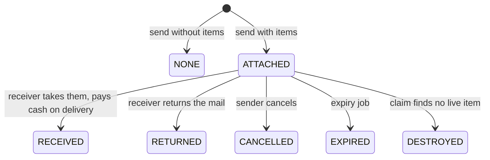

# 010 — Mail

The in-game postbox as a module shared by the chronicles: letters from players and the system with attachments,
cash on delivery, return, cancel, expiry, and a history that keeps every attachment as an item snapshot after the
items were taken. The first business module built on the canon of [spec 003](../003-engine-core/spec.md) and the
first consumer of value transactions ([persistence.md §3](../003-engine-core/persistence.md#3-value-transactions)).
Issue: [#150](https://github.com/l2nx/nx-l2/issues/150).

Companion: [client-protocol.md](client-protocol.md) — what the High Five client does with the mail packets and how
snapshots are shown in it.

## 1. Decisions

| #   | Decision                                                                                                                                                                                               | Why                                                                                                                                                |
| --- | ------------------------------------------------------------------------------------------------------------------------------------------------------------------------------------------------------ | -------------------------------------------------------------------------------------------------------------------------------------------------- |
| D1  | Module `engine/mail` (`app.l2nx.engine.mail`), shared by every chronicle with a postbox; a chronicle implements an SPI (§3)                                                                            | the overlap is proven against the Mobius trees (below); Interlude has no postbox and does not include the module                                   |
| D2  | The database is the source of truth; no mail is held in memory. Reads are asynchronous queries off the world loop; no JDBC on a loop thread                                                            | mail is rare and often addressed to an offline character; a cache would have to stay consistent with offline writes                                |
| D3  | The database row serializes concurrent changes: `UPDATE ... WHERE attachments = 'ATTACHED'`                                                                                                            | a receive racing a cancel or an expiry has exactly one winner                                                                                      |
| D4  | Mail is not a global service ([spec 003 §3](../003-engine-core/spec.md))                                                                                                                               | follows from D2 and D3: a single writer in memory would only add a cache                                                                           |
| D5  | Every value move is a value transaction with an `idempotency_key`                                                                                                                                      | one save point, no duplication or loss; a retry with the same key answers `Replayed`                                                               |
| D6  | Every attachment is stored as an item snapshot at send time and never changes; it is shown in the mail after the items were taken                                                                      | attachment history                                                                                                                                 |
| D7  | Deletion and expiry only hide a mail from a mailbox; the rows stay with the time and the reason                                                                                                        | history for administration, duplication analysis and the platform                                                                                  |
| D8  | Rules are settings (`l2nx.mail.*`) with the retail values as module defaults; a chronicle overrides only what differs (Essence: no peace-zone rule, refused in combat and when dead) | one module, rules chosen by the operator                                                                                                           |
| D9  | `custom_mails` and its polling manager are removed; scripts and the platform send through `MailService`                                                                                                | an outside writer sends a command ([persistence.md §6](../003-engine-core/persistence.md#6-schema-rules))                                          |
| D10 | The SPI has two sides: the world loop (live objects) and the transaction (SQL over the chronicle's tables: items, characters, block list); the module never writes a chronicle table itself            | the chronicle owns those tables                                                                                                                    |
| D11 | An online side is written with absolute values from memory under an owner condition; an offline side by delta under `CHECK (count >= 0)`                                                               | the database lags an online character's memory until the next save                                                                                 |
| D12 | While a value transaction is in flight for a character, its reserved items are not saved, and its world entry and logout wait; pending marks are checked in the mutating operations of item containers | a save of the pre-commit memory would undo a committed move ([persistence.md §3.1](../003-engine-core/persistence.md#31-online-and-offline-sides)) |
| D13 | The mail id on the wire is a session-local number (a table of at most 480 entries), not a wire handle                                                                                                  | mail takes nothing from the global allocator and nothing outlives the session                                                                      |
| D14 | Snapshots go to the client with synthetic handles `slot + 1`, below the live handle range `0x10000000`                                                                                                 | the client never sends attachment ids back and cannot confuse them with inventory items                                                            |
| D15 | Receive on a settled mail answers system message 3382, cancel answers 3030                                                                                                                             | protocol 267 has no "already received" flag; the client shows the buttons whenever items are listed                                                |
| D16 | Return creates a new mail to the sender with `returned_from_id` and copies of the snapshot rows                                                                                                        | the original stays in the history as `RETURNED`                                                                                                    |
| D17 | Deleting a character returns its received `ATTACHED` player mail to the live senders, destroys the attachments nobody can get (system mail, sender gone; ledger records it, the mail settles `DESTROYED`), drops the cash on delivery of its sent mail and nulls its id in the mail rows | the names captured at send keep the history readable                                                                                               |
| D18 | A claim that finds no live item left (destroyed outside mail) settles the mail `DESTROYED` without charging the cash on delivery                                                                       | nobody pays for an empty mail ([#57](https://github.com/l2nx/nx-l2/issues/57))                                                                     |
| D19 | Engine modules ship their changelogs under `db/engine/<module>/`, included explicitly by the server changelog; `items.mail_id` gets its foreign key in a chronicle changeset after the include         | a module cannot know a chronicle's `includeAll` directory ([spec 006 §2](../006-database.md#2-migrations))                                         |

**Overlap proof (D1).** [Spec 001 §4](../001-project-design.md#4-module-layout) moves a mechanic into `engine/` once
the chronicles are proven identical in it. The Mobius High Five and Essence trees share the limits (name 16, subject
128, body 512, 8 attachments, 240 mails per box), the fee (100 + 1000 per attachment), the expiry (360 h, 12 h with
cash on delivery), the expiry task, the cash-on-delivery rules and the handler set. They differ in where attachments
are allowed (High Five: peace zone; Essence: not in combat and not dead, peace zone for cancel), in Essence additions
(fee preview, unread counter, eleven mail types with commission blocks) and in the packets, which live in the protocol
adapters. Every SPI method below was checked against the Essence tree; what Essence adds lands as new mail types, an
extra snapshot table of its chronicle and its own protocol mappers.

## 2. Model

Every closed vocabulary is a Java enum stored by `name()` in a `text` column with `CHECK (col IN (...))`
([spec 006 §3](../006-database.md#3-schema)).

### 2.1 Tables of `engine/core` persistence

```sql
CREATE TABLE value_transactions (
    id uuid PRIMARY KEY,
    idempotency_key uuid NOT NULL UNIQUE,
    type text NOT NULL CHECK (type IN ('MAIL_SEND', 'MAIL_RECEIVE', 'MAIL_RETURN', 'MAIL_CANCEL', 'MAIL_EXPIRE',
        'MAIL_CHARACTER_DELETE')),
    -- the main entity of the transaction (a mail); returned on Replayed
    subject_id uuid,
    committed_at timestamptz NOT NULL
);

CREATE TABLE value_ledger (
    id uuid PRIMARY KEY,
    transaction_id uuid NOT NULL REFERENCES value_transactions (id),
    holder_type text NOT NULL CHECK (holder_type IN ('INVENTORY', 'WAREHOUSE', 'MAIL')),
    -- a character for INVENTORY and WAREHOUSE, a mail for MAIL
    holder_id uuid NOT NULL,
    item_template_id integer NOT NULL,
    item_id uuid NOT NULL,
    delta bigint NOT NULL CHECK (delta <> 0)
);

CREATE INDEX value_ledger_transaction_id_idx ON value_ledger (transaction_id);
CREATE INDEX value_ledger_item_id_idx ON value_ledger (item_id);
```

The `type` list grows with each consumer. The ledger records every value move: adena (fee, cash on delivery on both
sides), stackable items on each side of a move, a non-stackable item as `±1`; append-only.

### 2.2 Tables of `engine/mail`

```sql
CREATE TABLE mails (
    id uuid PRIMARY KEY,
    type text NOT NULL CHECK (type IN ('PLAYER', 'SYSTEM', 'BIRTHDAY')),
    -- NULL: system mail, or the sender was deleted
    sender_id uuid REFERENCES characters (id) ON DELETE SET NULL,
    -- captured at send; NULL for system mail, the protocol shows its system sender
    sender_name text CHECK (sender_name <> ''),
    receiver_id uuid REFERENCES characters (id) ON DELETE SET NULL,
    receiver_name text NOT NULL CHECK (receiver_name <> ''),
    subject text NOT NULL CHECK (subject <> ''),
    body text CHECK (body <> ''),
    cod_adena bigint CHECK (cod_adena > 0),
    attachments text NOT NULL CHECK (attachments IN
        ('NONE', 'ATTACHED', 'RECEIVED', 'RETURNED', 'CANCELLED', 'EXPIRED', 'DESTROYED')),
    returned_from_id uuid REFERENCES mails (id),
    sent_at timestamptz NOT NULL,
    expires_at timestamptz NOT NULL,
    read_at timestamptz,
    -- when the attachments left ATTACHED
    settled_at timestamptz,
    sender_deleted_at timestamptz,
    receiver_deleted_at timestamptz,
    -- processed by the expiry job; both boxes hide the mail
    expired_at timestamptz,
    CHECK ((cod_adena IS NULL) OR (attachments <> 'NONE'))
);

CREATE INDEX mails_inbox_idx ON mails (receiver_id) WHERE receiver_deleted_at IS NULL AND expired_at IS NULL;
CREATE INDEX mails_outbox_idx ON mails (sender_id) WHERE sender_deleted_at IS NULL AND expired_at IS NULL;
CREATE INDEX mails_due_idx ON mails (expires_at) WHERE expired_at IS NULL;
-- full indexes for the ON DELETE SET NULL actions, dropping cash on delivery and returned-mail lookups
CREATE INDEX mails_sender_id_idx ON mails (sender_id);
CREATE INDEX mails_receiver_id_idx ON mails (receiver_id);
CREATE INDEX mails_returned_from_id_idx ON mails (returned_from_id);

-- the item snapshot of an attachment, written once at send
CREATE TABLE mail_attachments (
    mail_id uuid NOT NULL REFERENCES mails (id),
    slot smallint NOT NULL CHECK (slot BETWEEN 0 AND 7),
    item_template_id integer NOT NULL,
    count bigint NOT NULL CHECK (count > 0),
    enchant_level integer NOT NULL,
    custom_type1 integer NOT NULL,
    custom_type2 integer NOT NULL,
    mana_left integer,
    item_expires_at timestamptz,
    augmentation_option1 integer,
    augmentation_option2 integer,
    attack_element smallint,
    attack_element_power integer,
    fire integer,
    water integer,
    wind integer,
    earth integer,
    holy integer,
    dark integer,
    enchant_option1 integer,
    enchant_option2 integer,
    enchant_option3 integer,
    PRIMARY KEY (mail_id, slot)
);
```

- Instants are wall clock: a mail outlives the process.
- The snapshot is taken on the world loop from the live item. Fields only one chronicle has (Essence soul crystal
  options, visual id, blessed, pet evolution) go into a table of that chronicle keyed by `(mail_id, slot)`, written by
  its SPI in the same transaction; High Five has none.
- The live items of a mail stay `items` rows with `location = 'MAIL'` and `mail_id`; no item of a mail is loaded into
  memory. When they leave the mail, the snapshot rows stay.
- High Five: the mail tables leave `000-baseline.sql`, `custom_mails` is dropped, and a chronicle changeset adds the
  foreign key `items.mail_id → mails (id)` after the module's include (D19).

### 2.3 States



- **Return** creates a mail to the sender (`returned_from_id` = original, the original's type, no cash on delivery,
  its own expiry); the live items move to it, its snapshot rows are copies (D16).
- **Cancel** moves the items back to the sender and hides the mail from the receiver.
- **Expiry** moves the items to the sender's warehouse (system mail: the receiver's) and hides the mail from both
  boxes; a mail without attachments expires by hiding only.
- A side may delete (hide) a mail only when its attachments are not `ATTACHED`.

### 2.4 Mail types

`MailType`: `PLAYER`, `SYSTEM`, `BIRTHDAY`. The type decides whom the client shows as sender: the player, the
system, or the birthday sender of the client (High Five shows Alegria). A mail is system mail when its type is not
`PLAYER`; system mail cannot be returned or replied to. The set grows with the chronicles (the Essence types when
Essence arrives); the wire value of each type is protocol code ([client-protocol.md §2](client-protocol.md#2-fields-and-their-meaning-in-the-client)).

### 2.5 Settings

`l2nx.mail.*`, a `@ConfigurationProperties` record of the module with the retail values as defaults, replacing `AllowMail`, `AllowAttachments`, the
`SendMail` flood protector and the constants of the legacy classes:

| Key                           | Default           | Meaning                                                                 |
| ----------------------------- | ----------------- | ----------------------------------------------------------------------- |
| `enabled`                     | `true`            | the postbox at all                                                      |
| `attachments.enabled`         | `true`            | items and cash on delivery                                              |
| `attachments.peace-zone-only` | `true`            | attachment actions (send, receive, return, cancel) only in a peace zone |
| `attachments.deny-in-combat`  | `false`           | attachment actions refused in combat                                    |
| `attachments.deny-when-dead`  | `false`           | attachment actions refused while dead                                   |
| `fee.base`                    | `100`             | adena per mail                                                          |
| `fee.per-attachment`          | `1000`            | adena per attachment                                                    |
| `mailbox-limit`               | `240`             | visible mails per box                                                   |
| `expiry`                      | `360h`            | lifetime of a mail                                                      |
| `cod-expiry`                  | `12h`             | lifetime of a mail with cash on delivery                                |
| `max-attachments`             | `8`               | attachments per mail, 1–8 (the snapshot has 8 slots; the client shows 8)  |
| `send-interval`               | `10s`             | minimum time between two sends of a character (10 s on retail)          |
| `expiry-poll`                 | `1m`              | cadence of the expiry job                                               |

The send interval is a per-character Bucket4j bucket (the standard rate limiter, already an `engine/core` dependency),
not an own timer map.

## 3. Module and contracts

```
app.l2nx.engine.mail
  (root)       MailService, MailRules, MailType, AttachmentState, MailRefusal, MailSettings, the SPI interfaces and
               their value types
  command/     commands and their handlers
  view/        view events and the read-only views of a mail and a snapshot
  system/      MailExpiry
  repository/  MailRepository, MailAttachmentRepository, MailRow, one class per value transaction (SendTransaction,
               SystemSendTransaction, ReceiveTransaction, CancelTransaction, ReturnTransaction, ExpireTransaction,
               CharacterDeletedTransaction) and MailWriter, the helpers they share
```

The module keeps the slice layout of [wiring-layout §4](../003-engine-core/wiring-layout.md#inside-a-slice), is a
Spring Modulith application module verified by `SliceLayoutRules`, and depends on no chronicle. Its commands enter
through the chronicle's protocol adapter; its view events leave through `ClientPort`.

### 3.1 Commands

```java
record SendMail(String receiverName, String subject, @Nullable String body, List<ItemCount> items,
        @Nullable Long codAdena) implements Command {}
record ItemCount(int itemHandle, long count) {}

record ListMailableItems() implements Command {}
record ListReceivedMail() implements Command {}
record ListSentMail() implements Command {}
record OpenReceivedMail(UUID mailId) implements Command {}
record OpenSentMail(UUID mailId) implements Command {}
record ReceiveAttachments(UUID mailId) implements Command {}
record ReturnMail(UUID mailId) implements Command {}
record CancelMail(UUID mailId) implements Command {}
record DeleteReceivedMail(List<UUID> mailIds) implements Command {}
record DeleteSentMail(List<UUID> mailIds) implements Command {}
```

Every handler runs in the world context. The protocol adapter resolves a wire mail number to its UUID through the
session's table (D13); a number it does not know is dropped as a malformed request.

### 3.2 View events

```java
record ReceivedMailList(List<MailSummary> mails) implements ViewEvent {}
record SentMailList(List<MailSummary> mails) implements ViewEvent {}
record MailSummary(UUID mailId, MailType type, @Nullable String counterpartName, String subject, Instant expiresAt,
        boolean unread, boolean codPending, boolean attachmentsTakeable, boolean returnable, boolean returned) {}

record ReceivedMailOpened(MailView mail) implements ViewEvent {}
record SentMailOpened(MailView mail) implements ViewEvent {}
record MailView(UUID mailId, MailType type, @Nullable String senderName, String receiverName, String subject,
        @Nullable String body, @Nullable Long codAdenaPending, AttachmentState attachments, boolean unread,
        boolean returnable, boolean returned, List<AttachmentSnapshot> snapshots) {}

record AttachmentSnapshot(int slot, int itemTemplateId, long count, int enchantLevel, int customType1,
        int customType2, @Nullable Integer manaLeft, @Nullable Instant itemExpiresAt,
        @Nullable Augmentation augmentation, @Nullable Elements elements, List<Integer> enchantOptions) {}

record MailableItems(List<Integer> itemHandles) implements ViewEvent {}
record MailArrived(boolean fresh) implements ViewEvent {}   // false: the notice at world entry
record MailSent() implements ViewEvent {}
record MailStateChanged(MailBox box, List<MailChange> changes) implements ViewEvent {}
record MailChange(UUID mailId, MailChangeType type) {}   // DELETED, READ, ATTACHMENTS_TAKEN
record MailRefused(MailAction action, MailRefusal reason, @Nullable String param) implements ViewEvent {}
record MailDone(MailNotice notice, @Nullable String name, long adena) implements ViewEvent {}
// MailAction: SEND, RECEIVE, RETURN, CANCEL, DELETE, READ
// MailNotice: SENT, RECEIVED, RETURNED, CANCELLED (to the actor); COD_PAID, ATTACHMENTS_TAKEN, RETURNED_TO_YOU,
//             EXPIRED_RETURNED (to the sender); CANCELLED_BY_SENDER (to the receiver)
```

`MailRefused` and `MailDone` are the module's own events: an engine module cannot depend on the chronicle's `message` slice, so the
protocol mapper turns them into the client's system messages; the action lets it pick the text the client has for
that action (a settled mail answers 3382 on receive and 3030 on cancel). `MailRefusal`:

| Group    | Values                                                                                    |
| -------- | ----------------------------------------------------------------------------------------- |
| settings | `DISABLED`, `ATTACHMENTS_DISABLED`, `NOT_IN_PEACE_ZONE`, `IN_COMBAT`, `DEAD`              |
| sender   | `BUSY` (trading, store, enchanting), `ACCESS_DENIED`, `JAILED`, `SEND_INTERVAL`, `NOT_ENOUGH_ADENA` |
| content  | `TOO_MANY_ATTACHMENTS`, `ITEM_NOT_MAILABLE`, `COD_WITHOUT_ATTACHMENTS`, `COD_AMOUNT_INVALID`, `INVALID_TEXT`    |
| receiver | `RECEIVER_NOT_FOUND`, `RECEIVER_SELF`, `RECEIVER_BLOCKED`, `RECEIVER_GM_ONLY`             |
| limits   | `RECEIVER_MAILBOX_FULL`, `SENDER_MAILBOX_FULL`, `INVENTORY_FULL`, `WEIGHT_LIMIT`, `ADENA_LIMIT`, `SENDER_ADENA_LIMIT`          |
| state    | `ALREADY_RECEIVED`, `NOT_RETURNABLE`, `HAS_ATTACHMENTS`                                   |
| system   | `FAILED` (the transaction failed before its commit)                           |

### 3.3 Module API

```java
public interface MailService {
    void sendSystem(SystemMail mail);
    void hasAttached(UUID characterId, IntSet itemTemplateIds, Executor resultLoop, Consumer<Boolean> result);
    // the character's row is removed only once done got true
    void onCharacterDeleted(UUID characterId, UUID idempotencyKey, Executor resultLoop, Consumer<Boolean> done);
    void onWorldEntered(MailActor actor);
}

record SystemMail(UUID receiverId, MailType type, String subject, String body, List<NewItem> items,
        UUID idempotencyKey) {}
record NewItem(int itemTemplateId, long count, int enchantLevel) {}
```

- `sendSystem` creates the items in the mail inside the send transaction; a repeated key sends nothing again. The
  High Five birthday gift is the first caller and derives its key from character and year; the platform adapter calls
  it at stage 5.
- `hasAttached` answers the ownership checks of scripts and events that also look into the mailboxes.
- `onWorldEntered` tells a character entering the world about unread mail.

### 3.4 Chronicle SPI

On the world loop, over live objects:

```java
public interface MailItems {
    List<Integer> mailable(int characterHandle);
    // marks the items and the fee pending, captures their rows and snapshots; ITEM_NOT_MAILABLE, NOT_ENOUGH_ADENA, BUSY
    ReserveResult<Reservation> reserve(int characterHandle, List<ItemCount> items, long adena);
    void release(Reservation reservation);
    void applyOutgoing(Reservation reservation);            // after commit, without writing the database
    // room for incoming items, the stacks they merge into marked pending; adena is the signed change of the adena row
    // holder: INVENTORY, or WAREHOUSE for expired attachments of an online owner (stacks null: not loaded, by delta)
    ReserveResult<IncomingTargets> incomingTargets(
            int characterHandle, HolderType holder, List<AttachmentSnapshot> items, long adena);
    void release(IncomingTargets targets);
    void applyIncoming(IncomingTargets targets, List<ItemRow> committedRows);
    long adenaLimit();
}

public interface MailParticipants {
    ContextResolver<MailActor> context();                   // the character a mail command acts for
    Executor loop();                                        // where results and outcomes are delivered
    ParticipantState state(int characterHandle);
    Optional<MailActor> online(UUID characterId);
    boolean refusesMailFrom(String receiverName, UUID senderId);   // an online receiver's block list or refusal mode
    void beginTransaction(UUID characterId);                // world entry, logout and save wait until the end
    void endTransaction(UUID characterId);
}

record MailActor(int characterHandle, UUID characterId, String name, ClientPort port) {}
record ParticipantState(boolean peaceZone, boolean inCombat, boolean dead, boolean busy, boolean tradeAllowed,
        boolean mailBlocked, boolean transactionsBlocked, boolean gm) {}
```

`busy` covers trading, store mode and enchanting; `mailBlocked` and `transactionsBlocked` are the chronicle's jail
rules (no mail at all; no attachments or cash on delivery). `online` also finds a character loaded into a session but
not yet in the world.
`beginTransaction` and `endTransaction` cover offline participants too, so a login racing a commit waits.

Inside a value transaction, over the chronicle's tables:

```java
public interface MailItemStore {
    Optional<Recipient> findRecipient(String name);
    Optional<Recipient> findRecipient(UUID id);
    boolean isBlocked(UUID receiverId, UUID senderId);
    List<ItemMovement> toMail(UUID mailId, List<ReservedItem> items);
    CreatedItems createInMail(UUID mailId, List<NewItem> items);
    // online: the stacks of an online target, absolute; null: an offline target, by delta with merge
    ItemTransfer toCharacter(UUID mailId, Holder target, List<ItemRowState> online);
    List<ItemMovement> toMailOf(UUID fromMailId, UUID toMailId);
    ItemTransfer adena(Holder holder, long delta, ItemRowState online);
    int liveItemsInMail(UUID mailId);
    List<ItemMovement> destroyInMail(UUID mailId);          // a mail nobody can get any more
    List<ItemRow> rows(List<UUID> itemIds);                 // committed rows, outside a transaction (replay)
    void checkCreatable(List<NewItem> items);               // static data only; sendSystem validates before the transaction
}
```

An item created after the character's last save has no row yet: its `ItemRowState` carries the whole row
(`unstoredRow`) and the store inserts it before moving it, so a fresh item or fresh adena can be mailed at once.
Every `ItemMovement` goes to the runner, which writes its ledger row. A replayed transaction carries its ledger rows
(`Replayed.movements`): the module reads the rows they name through `rows` and applies them to an online character as
after a commit. The mapping of `MailType` to the wire, the system sender name and the inventory refresh after a move
are protocol code of the chronicle's adapter.

### 3.5 Value transaction runner (`engine/core` persistence)

```java
public interface ValueTransactions {
    <R> void submit(ValueTransaction<R> tx, Executor resultLoop, Consumer<ValueOutcome<R>> onOutcome);
}

public interface ValueTransaction<R> {
    ValueTransactionType type();
    UUID idempotencyKey();
    R execute(ValueContext context) throws ValueRefusal;
}

sealed interface ValueOutcome<R> permits Committed, Replayed, Refused, Failed, Unknown {}
```

`ValueTransactionSubmitter` submits a transaction and dispatches its outcome to a `ValueOutcomeHandler`
(committed, replayed, refused, failed), resolving `Unknown` by lookup with backoff; `BackgroundQueries` runs read-only
queries off the loop and delivers them to it. Both are `engine/core` beans used by every slice. The runner executes `execute` in one `TransactionTemplate` on Boot's task executor, records the transaction and its
ledger rows, and offers the outcome to `resultLoop`; semantics in
[persistence.md §3](../003-engine-core/persistence.md#3-value-transactions).

## 4. Flows

Every refusal is a `MailRefused` to the acting character.

### 4.1 Send

1. **On the world loop:** postbox and attachments enabled; access level allows trade; attachment rules from the
   settings; not busy; not jailed (`mailBlocked`, or `transactionsBlocked` with attachments); an online receiver does
   not refuse the sender (`refusesMailFrom`); text bounds (name 1–16, subject 1–128, body up to 512); at most 8 attachments, each mailable and
   owned in that count; cash on delivery only with attachments and within the adena limit; fee affordable; send
   interval. Then the items and the fee are reserved and the snapshots taken; the partition creates the key.
2. **In the transaction:** resolve the receiver by name (`RECEIVER_NOT_FOUND`, `RECEIVER_SELF`, `RECEIVER_BLOCKED`,
   `RECEIVER_GM_ONLY`); the receiver's inbox and the sender's sent box below `mailbox-limit`; insert the mail
   and its snapshot rows; move the items (a whole row to `MAIL`, a part of a stack as a new row); take the fee.
3. **On commit:** apply to the sender, `MailSent` to the sender, `MailArrived` to the receiver if online.

### 4.2 Mailbox and reading

Lists and open mail are read-only queries off the loop; the result returns to the partition and is emitted as a view
event. Opening an unread received mail sets `read_at` (a conditional write) and emits `MailStateChanged`. Attachments
are always shown from the snapshot rows; whether they can still be taken comes from `attachments`. At world entry an
unread count query emits `MailArrived` when it is above zero. A box holds at most `mailbox-limit` visible mails, newest
first; when more are visible (returns are never refused), `ATTACHED` mails take the places first, so no attachment
drops out of the list.

### 4.3 Receive

1. Read the mail and its snapshot rows off the loop.
2. **On the loop:** attachment rules; the mail is the receiver's and `ATTACHED` (else `ALREADY_RECEIVED`); inventory
   slots and weight for the snapshot items; adena for the cash on delivery; reserve the receiver's adena and the stacks
   to merge into; take the sender's adena state if the sender is online.
3. **In the transaction:** condition `attachments = 'ATTACHED'`; move the live items to the receiver; pay the cash on
   delivery to the sender (online absolute, offline delta or a new adena row); settle `RECEIVED`, or `DESTROYED`
   without charging when no live item is left (D18).
4. **On commit:** apply to both characters, system messages to both, `MailStateChanged`; after a paid mail a fresh
   received list, since the client keeps the payment flag of a list it already shows.

A payment that would take the sender's adena over the adena limit is refused with `SENDER_ADENA_LIMIT` (the client's
"the opponent cannot accept the adena"); the receiver can still return the mail. A stackable template the receiver
(or the paid sender) has no stack of is reserved as awaited (`IncomingTargets.newStackTemplates`): a stack of it
created during the transaction is not saved and merges into the committed row, so memory and database keep one stack.

### 4.4 Return, cancel, delete

- **Return** (receiver): attachment rules; `ATTACHED`, not a returned mail, a `PLAYER` mail; creates the returned mail
  (D16) and notifies the sender.
- **Cancel** (sender): attachment rules; `ATTACHED` (else `ALREADY_RECEIVED`); the items back to the sender with
  merge; hides the mail for the receiver.
- **Delete** (either side, several mails at once): hides each mail whose attachments are not `ATTACHED`, refuses the
  rest with `HAS_ATTACHMENTS`, and reports every hidden mail.

### 4.5 Expiry

`MailExpiry` runs on the background executor every `expiry-poll`: it selects due mails in batches and runs one expiry
transaction per mail. Attachments still `ATTACHED` move to the warehouse of the sender (the receiver for system mail),
merged into existing stacks, whether the owner is online or not; an online owner's loaded warehouse is updated on
commit. An offline receiver of an expired system mail no longer leaves orphaned item rows, a defect of both Mobius
trees. For an online owner the job first reserves the stacks of the loaded warehouse on the loop, like a receive; a
stack another transaction holds leaves the mail due for the next poll. The warehouse has no capacity check here, as
in the legacy return: a refusal would hold the attachments in the mail forever. Adena over the adena limit is refused
(`ADENA_LIMIT`) and the mail stays due until there is room. A returned mail expires to its original sender (its
receiver); a mail whose owner no longer exists has its attachments destroyed (D17).

### 4.6 Character deletion

The deletion of a character calls `MailService.onCharacterDeleted` before its row is removed: one transaction
returns its `ATTACHED` received player mail to the live senders, destroys the attachments of the rest (system mail,
sender gone) and drops the cash on delivery of its sent mail; the foreign keys then null its id (D17). Expiry treats a
mail whose warehouse owner no longer exists the same way. The character row is removed only once the mail transaction committed; a failed attempt
leaves the character, and the deletion is tried again the next time the character list is shown (a due deletion is
`now >= deleteAt`, an immediate one sets `deleteAt = now` first).

## 5. Platform events (stage 5)

The adapter will publish one event per committed transaction from the outbox
([persistence.md §5](../003-engine-core/persistence.md#5-outbox)): sent, received, returned, cancelled, read, deleted,
expired, with the mail id and the snapshot rows of the items that moved. The outbox table and its publisher come with
the adapter; the transactions above are where they are written.

## 6. Verification

- **Unit:** every handler on `WorldLoopExtension`, each refusal and each setting; the High Five snapshot of an item
  with enchant, augmentation, elements and enchant options.
- **PostgreSQL integration (Testcontainers):** the repositories and every transaction; a retry with the same key
  replays; receive against cancel and receive against expiry commit exactly one; a transaction whose connection is
  killed before commit changes nothing; offline receive and expiry with stack merge; the ledger reconciles with the
  item counts.
- **Architecture:** `SliceLayoutRules` covers `app.l2nx.engine.mail`; the module depends on no chronicle;
  `l2nx.engine.jdbc.on.loop` stays zero in the mail flows.
- **Real client (relay):** send with enchanted, augmented and elemental items and cash on delivery, receive, open the
  mail again and see the snapshot, press Receive on it, return, cancel, delete, expiry; screenshots for the dev portal
  page.

## 7. Documentation

Dev portal page `docs/public/{en,ru}/features/mail.md` (l2nx.dev `/core/features/mail/`): the functional part with
in-game screenshots and the technical part (module, value transactions, snapshot, history). The diagrams are
generated by `docs/diagrams/mail/` (shared helpers in `docs/diagrams/svgkit.py`).

## 8. Deferred

- Outbox and adapter commands for mail (stage 5, [#13](https://github.com/l2nx/nx-l2/issues/13)).
- A client patch that hides Receive and Cancel on a settled mail ([client-protocol.md §4](client-protocol.md#4-snapshot-in-the-mail-window)).
- Trade, warehouses and stores on value transactions (E3).
